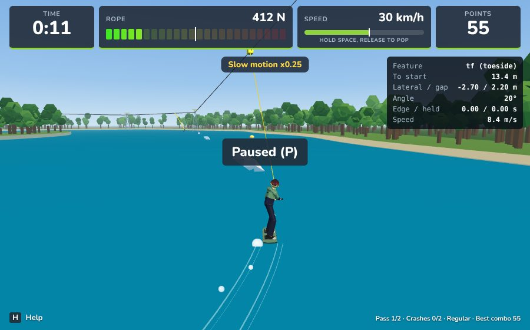
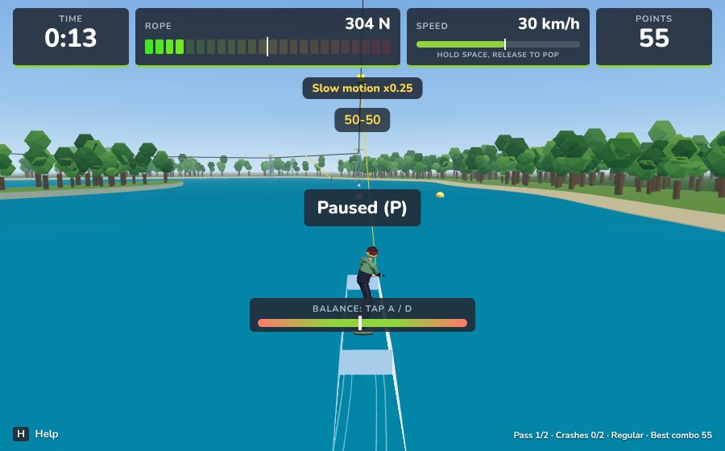
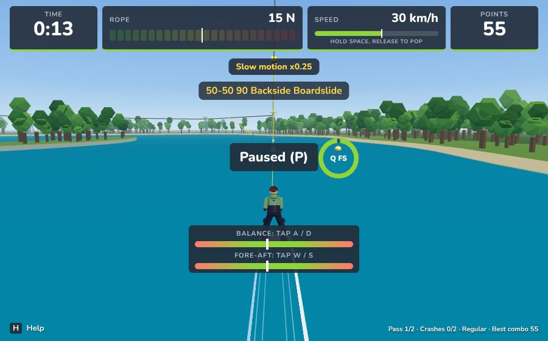
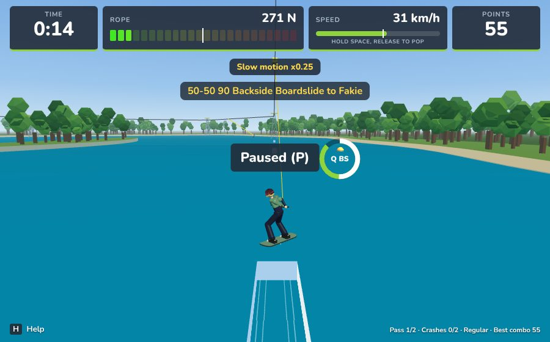
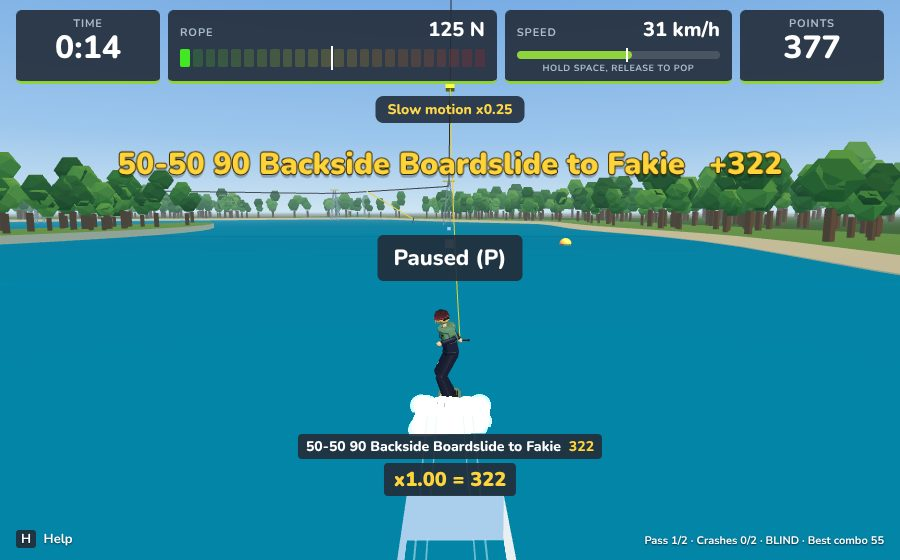

# Feature riding: report

The "Realistic Feature Riding Mechanics" spec, milestones 1 to 10. The rules
and their numbers are in docs/MECHANICS.md (section 7, Features). This file
covers:
- the module set;
- the scenario suite's results;
- the values tuned or changed;
- the decisions taken where the spec and the existing game disagreed.

## Modules

Everything is in the simulation, so the web game and the Roblox game ride
the same way. The TypeScript is in `src/sim/featureRide/`; each file has a
bit-identical Luau twin, `roblox/src/shared/Sim/FeatureRide<Name>.luau`.

| Spec module | File | What it does |
|---|---|---|
| FeatureRideConfig | `config.ts` (`DEFAULT_CONFIG.featureRide`) | Every number below, generated into Config.luau |
| ApproachTracker | `approachTracker.ts` | Distance, lateral offset, angle, heelside / toeside / front, edge and its hold time; the F8 approach guide |
| EntryResolver | `entryResolver.ts` | Side hop, edge crossings (clearance, tail clip, nose hit, overshoot), landing on a main (roll, snap, balance width, impact, skid), landing on a safety, landing in a gap |
| SlideController | `slideController.ts` | Friction by material and slide, stalls, kinks, two-axis balance, rope spikes, sketchy exits |
| FeatureRotation | `featureRotation.ts` | Boardslide / lipslide and frontside / backside naming, 90-degree hop steps, chained rotations, hard way, handle pass, run-out |
| PressController | `pressController.ts` | Nose and tail presses, the narrowing fore-aft window, end taps |
| ExitResolver | `exitResolver.ts` | Ride-off (with the 45-degree assist), pop-off, side pop, hop, transfers, the `featureLine` event |
| FeatureSpecials | `featureSpecials.ts` | Funbox down end, rotations on slopes, a wall ride too slow, a spine missed |
| FeatureTrickNamer | `featureTrickNamer.ts` | Pure names for a whole line |
| FeatureScoring | `featureScoring.ts` | One trick per line: per metre, coverage, rotations, factors, difficulty |

The animation gets these through the rider anim state: `feature.slide`,
`feature.balance`, `feature.fore`, `feature.press` and `feature.entry`; the
board angle comes from the jib.

## Scenario suite (spec 12.2)

Scripted, deterministic riders run on seven slide features plus the rooftop.
- *Features*: the old box, rail and pipe defs, and the catalogue Slider,
  FlatRail, PipeRail and GapBox.
- *Pass scenarios* may search a small grid of timings and charges, like a
  rider trying a few lines. Each passes if one line does the trick cleanly.
- *Fail scenarios* must crash with the named reason.
- *Where it lives*: `tests/scenarios/featureScenarios.ts`; the test is
  `tests/featureScenarios.test.ts`.
- *Table*: `npx vite-node scripts/feature-ride-report.ts` prints it (the
  full list of lines used is at the end of this file).

| Scenario | Box | Rail | Pipe | Slider | FlatRail | PipeRail | GapBox | Rooftop |
|---|---|---|---|---|---|---|---|---|
| P1 Front ollie-on with enough charge: 50-50 | pass | pass | pass | pass | pass | pass | pass | n/a |
| P2-heelside Side ollie-on from the heelside: 50-50 | pass | pass | pass | pass | pass | pass | pass | n/a |
| P2-toeside Side ollie-on from the toeside: 50-50 | pass | pass | pass | pass | pass | pass | pass | n/a |
| P3-heelside Side ollie-on with a 90 from the heelside: backside boardslide | pass | pass | pass | pass | pass | pass | pass | n/a |
| P3-toeside Side ollie-on with a 90 from the toeside: frontside boardslide | pass | pass | pass | pass | pass | pass | pass | n/a |
| P4 Ride up the safety (flush): 50-50 | pass | pass | pass | pass | pass | pass | n/a | n/a |
| P5 Ollie onto the safety, then pop in the window: onto the main | pass | pass | pass | pass | pass | pass | pass | n/a |
| P6 Pop off the safety with a 180-in: switch 50-50 | pass | pass | pass | pass | pass | pass | pass | n/a |
| P7-back 50-50, then A on the feature: backside boardslide | pass | pass | pass | pass | pass | pass | pass | n/a |
| P7-front 50-50, then D on the feature: frontside boardslide | pass | pass | pass | pass | pass | pass | pass | n/a |
| P8-180 Exit: 180-out from a 50-50 | pass | pass | pass | pass | pass | pass | pass | n/a |
| P8-270 Exit: 270-out from a boardslide | pass | pass | pass | pass | pass | pass | pass | n/a |
| P8-fakie Exit: a boardslide ridden off, turned to fakie | pass | pass | pass | pass | pass | pass | pass | n/a |
| F1 Ollie too low for the front: ShortOllie | pass | pass | pass | pass | pass | pass | pass | n/a |
| F2 Side ollie too low: ClippedSide (or a TailClip within tolerance) | pass | pass | pass | pass | pass | pass | pass | n/a |
| F3 Side approach at 40 degrees: NoseHitSide | pass | pass | pass | pass | pass | pass | pass | n/a |
| F4 Side hop too strong: Overshoot | pass | pass | pass | pass | pass | pass | pass | n/a |
| F5 Gap box with no pop: MissedSafetyPop / LandedInGap | n/a | n/a | n/a | n/a | n/a | n/a | pass | n/a |
| F6 Hard edge held to takeoff on a backside entry: SlippedOut | pass | pass | pass | pass | pass | pass | pass | n/a |
| F7 Backside rotation on the feature without Q: HandleDropped | pass | pass | pass | pass | pass | pass | pass | n/a |
| F8 Rooftop at low speed: Stalled | n/a | n/a | n/a | n/a | n/a | n/a | n/a | pass |

134/134 runs pass

Unit tests:
- `tests/featureRide.test.ts`: tracker, resolver, slide physics, balance,
  rotations, presses, exits and specials. It includes the resolution table
  for every approach side, rotation direction, stance and switch (16 cases).
- `tests/featureNames.test.ts`: the namer, with section 8's nine examples
  exactly and 17 more, plus scoring.

Parity tests (`tests/parity.test.ts`):
- 18 scripted entries traced tick by tick in TypeScript and Luau;
- the Luau namer on all 26 names;
- random runs on the test and catalogue maps.

## Captures (web game, `?park=test`)

| | |
|---|---|
|  F8 approach guide on the way to the funbox |  Ride-on 50-50: the name builds on the HUD |
|  A on the box: "50-50 90 Backside Boardslide", both balance meters |  Ridden off the end, turning to fakie |
|  On the water: "50-50 90 Backside Boardslide to Fakie +322" | |

## Values tuned or changed

| Value | Was | Now | Why |
|---|---|---|---|
| `safety.popWindowMinMetres` | 1.0 m | 0.5 m | Spec 3.6 (last 8%, at least 0.5 m) |
| Ollie-on clearance | `ollie.clearance` 0.10 m | `Entry.Clearance` 0.08 m + `TailClipTolerance` 0.10 m | Spec 3.2. `ollie.clearance` is no longer read for mains |
| Landing yaw on a feature | `landing.maxYawError` 35 deg | `Landing.SnapTolerance` 20 deg, sketchy to 30 | Spec 4.2 |
| Feature landing impact | leg capacity (9 m/s or more) | `HardImpact` 5 / `CrashImpact` 8 m/s | Spec 4.4 |
| Slide friction on the old defs | `feature.friction` 0.08 | material: HDPE 0.06, pipe 0.05; boardslide x1.6, press x0.8 | Spec 5.1 (the catalogue already used the material values) |
| Stall on a slide | `feature.stallSpeed` 0.8 m/s, `fellOffFeature` | `Slide.StallSpeed` 1.0 m/s, `stalled` | Spec 5.1. Ramps and walls still use 0.8 |
| Balance drift, taps, rope tip | `feature.balanceDriftBox` / `Rail`, `balanceNoiseRate`, `tapStrength`, `ropeTip` | moved to `featureRide.Balance` (same values); `NoisePipe` 2.0 added | One home for every feature riding number |
| Side pops | Only catalogue features (`feature.sideHop`) | Every feature | Spec 6.1 |
| Flush safety pop | Mounted the main directly | Goes into the air (in-rotations); early pops have to clear the main | Spec 3.6 |
| GapBox main | 6 m | 10 m | Its 17-degree safety throws a rider about 5 m at cable speed, which left too little box to slide. Real gap boxes are 6 to 10 m; the layout still validates |
| `Ollie.MaxV` | 6.5 m/s | kept | See the decisions below |

New numbers (all in `featureRide`, see docs/MECHANICS.md for each):
- *Side entries*:
  - `SideEntry.MaxAngle` 25 deg, `MaxLateral` 2.5 m, hop 1.5 to 3.0 m/s.
  - Balance width: box top minus 0.2 m, rail 0.15 m, pipe 0.1 m.
  - `OvershootRecover` 0.1 m, `OvershootCatch` 0.3 m.
- *Landing*:
  - `MaxRoll` 12 deg (sketchy over 8).
  - Slip roll 16 / 10 / 6 deg (heelside / toeside / front) within 0.2 s of a hard edge.
  - Skid over 90 deg/s.
  - The safety's pitch tolerance is 15 deg, a crash past 30.
- *Kinks*: lift 0.068 x angle x speed, 0.05 to 0.15 s. A speed check over
  12 deg against 12 m/s x 12 / angle, sketchy up to 15% over.
- *Balance*:
  - Noise: box 0.9, rail 1.6, pipe 2.0.
  - By slide: boardslide x1.3; on a pipe, 50-50 x1.25 and boardslide x0.85.
  - Rope spike 1600 N gives 0.35.
  - Fore-aft: rope 4000 N, W/S taps 0.35.
  - The last metre is a sketchy exit.
- *Rotations*: hard way 0.3 balance hit. Rotations on slopes over 5 deg cost
  0.2.
- *Presses*: 10 deg, 0.15 s to rock on. The window narrows 0.25 per s, to
  0.2. End taps count in the last 0.5 m.
- *Exits*: pop-off zone 1.0 m. Ride-off assist within 45 deg, at 360 deg/s.
- *Specials*:
  - Funbox down-end pops x0.7.
  - Wall ride: too slow within 0.6 m up is sketchy, higher is `wallSlideDown`.
  - Spine: missed and down faster than 6.5 m/s is `hardLanding`.
- *Scoring*:
  - Per metre: 50-50 10, boardslide 15, lipslide 18, press 20, wall ride 15.
  - Full Feature +150 at 90% of the main.
  - 40 per 90 degrees; hard way x1.3, pretzel x1.2, switch x1.1.
  - Entry bonus: pop-on 100, side ollie-on 80, transfer 60, ollie-on 50,
    pop 40.
  - End tap 50.
  - Difficulty: 0.85 + 0.15 x level.

## Decisions where the spec and the game disagreed

1. **Where the modules live.** They are sim modules, not a separate
   Roblox-only `FeatureRide/` folder, so the web game and Roblox share them
   bit for bit. Each has a `FeatureRide*.luau` twin.
2. **`Ollie.MaxV` kept at 6.5 m/s.**
   - From the water the highest main (1.0 m: funbox, kink rail, step-up top)
     needs 4.6 m/s, about 37% charge.
   - The spec asks for a near-full charge there. That would mean MaxV of
     about 4.9 m/s, which would also cut every flat-water air.
   - The rooftop's 1.2 m top is reached by riding up it.
3. **Names.**
   - The slide ids stay `backboard` / `frontboard`, now named "Backside /
     Frontside Boardslide". Lipslides are new ids.
   - The old "270 Off" exit names are replaced by the spec's "-out" and "to
     Fakie / Forward".
   - "Pop-on" is only a clean pop, the centre of the window. Any other
     safety pop has no entry word, so the spec's example "270-in Backside
     Boardslide 270-out Pretzel" comes out exactly.
4. **Scoring.** A whole feature line is one trick, scored when the rider lands
   on the water. Before, a slide and its exit air were scored separately.
   Airs onto or off a feature no longer score on their own.
5. **ShortOllie with a flush safety in front.** A low ollie lands on the
   safety (spec 3.5) rather than hitting the main's front. ShortOllie needs a
   low pop off the safety itself, which is how the scenario does it.
6. **No Studio.** Everything is tested under the plain `luau` CLI and
   captured from the web game; the Roblox client's HUD shows the line names
   and both balance axes the same way.

## Every scenario run

| Scenario | Feature | Result | Line used / outcome |
|---|---|---|---|
| P1 | Box | pass | pop 5 m before the main, 0.25 s: ollieOn fiftyFifty |
| P1 | Rail | pass | pop 5 m before the main, 0.25 s: ollieOn fiftyFifty |
| P1 | Pipe | pass | pop 5 m before the main, 0.25 s: ollieOn fiftyFifty |
| P1 | Slider | pass | pop 5 m before the main, 0.25 s: ollieOn fiftyFifty |
| P1 | FlatRail | pass | pop 5 m before the main, 0.25 s: ollieOn fiftyFifty |
| P1 | PipeRail | pass | pop 5 m before the main, 0.25 s: ollieOn fiftyFifty |
| P1 | GapBox | pass | pop 5 m before the main, 0.25 s: ollieOn fiftyFifty |
| P2-heelside | Box | pass | 0.4 m beside, pop at -0.5 m, 0.05 s: sideOllieOn fiftyFifty |
| P2-heelside | Rail | pass | 0.8 m beside, pop at -0.5 m, 0.05 s: sideOllieOn fiftyFifty |
| P2-heelside | Pipe | pass | 0.6 m beside, pop at -0.5 m, 0.05 s: sideOllieOn fiftyFifty |
| P2-heelside | Slider | pass | 0.4 m beside, pop at -0.5 m, 0.05 s: sideOllieOn fiftyFifty |
| P2-heelside | FlatRail | pass | 0.8 m beside, pop at -0.5 m, 0.15 s: sideOllieOn fiftyFifty |
| P2-heelside | PipeRail | pass | 0.4 m beside, pop at -0.5 m, 0.05 s: sideOllieOn fiftyFifty |
| P2-heelside | GapBox | pass | 0.6 m beside, pop at -0.5 m, 0.15 s: sideOllieOn fiftyFifty |
| P2-toeside | Box | pass | 0.4 m beside, pop at -0.5 m, 0.05 s: sideOllieOn fiftyFifty |
| P2-toeside | Rail | pass | 0.8 m beside, pop at -0.5 m, 0.05 s: sideOllieOn fiftyFifty |
| P2-toeside | Pipe | pass | 0.6 m beside, pop at -0.5 m, 0.05 s: sideOllieOn fiftyFifty |
| P2-toeside | Slider | pass | 0.4 m beside, pop at -0.5 m, 0.05 s: sideOllieOn fiftyFifty |
| P2-toeside | FlatRail | pass | 0.8 m beside, pop at -0.5 m, 0.15 s: sideOllieOn fiftyFifty |
| P2-toeside | PipeRail | pass | 0.4 m beside, pop at -0.5 m, 0.05 s: sideOllieOn fiftyFifty |
| P2-toeside | GapBox | pass | 0.6 m beside, pop at -0.5 m, 0.15 s: sideOllieOn fiftyFifty |
| P3-heelside | Box | pass | 0.4 m beside, pop at -0.5 m, 0.05 s, turn 0.2 s: sideOllieOn backboard |
| P3-heelside | Rail | pass | 0.8 m beside, pop at -0.5 m, 0.05 s, turn 0.2 s: sideOllieOn backboard |
| P3-heelside | Pipe | pass | 0.6 m beside, pop at -0.5 m, 0.05 s, turn 0.17 s: sideOllieOn backboard |
| P3-heelside | Slider | pass | 0.4 m beside, pop at -0.5 m, 0.05 s, turn 0.2 s: sideOllieOn backboard |
| P3-heelside | FlatRail | pass | 0.8 m beside, pop at -0.5 m, 0.15 s, turn 0.2 s: sideOllieOn backboard |
| P3-heelside | PipeRail | pass | 0.4 m beside, pop at -0.5 m, 0.05 s, turn 0.2 s: sideOllieOn backboard |
| P3-heelside | GapBox | pass | 0.6 m beside, pop at -0.5 m, 0.15 s, turn 0.2 s: sideOllieOn backboard |
| P3-toeside | Box | pass | 0.4 m beside, pop at -0.5 m, 0.05 s, turn 0.2 s: sideOllieOn frontboard |
| P3-toeside | Rail | pass | 0.8 m beside, pop at -0.5 m, 0.05 s, turn 0.2 s: sideOllieOn frontboard |
| P3-toeside | Pipe | pass | 0.6 m beside, pop at -0.5 m, 0.05 s, turn 0.17 s: sideOllieOn frontboard |
| P3-toeside | Slider | pass | 0.4 m beside, pop at -0.5 m, 0.05 s, turn 0.2 s: sideOllieOn frontboard |
| P3-toeside | FlatRail | pass | 0.8 m beside, pop at -0.5 m, 0.15 s, turn 0.2 s: sideOllieOn frontboard |
| P3-toeside | PipeRail | pass | 0.4 m beside, pop at -0.5 m, 0.05 s, turn 0.2 s: sideOllieOn frontboard |
| P3-toeside | GapBox | pass | 0.6 m beside, pop at -0.5 m, 0.15 s, turn 0.2 s: sideOllieOn frontboard |
| P4 | Box | pass | rideOn fiftyFifty |
| P4 | Rail | pass | rideOn fiftyFifty |
| P4 | Pipe | pass | rideOn fiftyFifty |
| P4 | Slider | pass | rideOn fiftyFifty |
| P4 | FlatRail | pass | rideOn fiftyFifty |
| P4 | PipeRail | pass | rideOn fiftyFifty |
| P5 | Box | pass | 0.4 m beside, hop at -7.75 m, 0.08 s: airborne > onSafety > airborne > onFeature > airborne |
| P5 | Rail | pass | 0.8 m beside, hop at -6.5 m, 0.03 s: airborne > onSafety > airborne > onFeature > airborne |
| P5 | Pipe | pass | 0.6 m beside, hop at -5.75 m, 0.03 s: airborne > onSafety > airborne > onFeature > airborne |
| P5 | Slider | pass | 0.4 m beside, hop at -7.75 m, 0.08 s: airborne > onSafety > airborne > onFeature > airborne |
| P5 | FlatRail | pass | 0.4 m beside, hop at -5.75 m, 0.03 s: airborne > onSafety > airborne > onFeature > airborne |
| P5 | PipeRail | pass | 0.4 m beside, hop at -6 m, 0.03 s: airborne > onSafety > airborne > onFeature > airborne |
| P5 | GapBox | pass | 0.4 m beside, hop at -7.5 m, 0.08 s: airborne > onSafety > airborne > onFeature > airborne |
| P6 | Box | pass | pop 0.6 m before the main, 0.2 s, turn 0.3 s: pop switchFiftyFifty |
| P6 | Rail | pass | pop 0.6 m before the main, 0.2 s, turn 0.3 s: pop switchFiftyFifty |
| P6 | Pipe | pass | pop 0.6 m before the main, 0.2 s, turn 0.25 s: pop switchFiftyFifty |
| P6 | Slider | pass | pop 0.6 m before the main, 0.2 s, turn 0.3 s: pop switchFiftyFifty |
| P6 | FlatRail | pass | pop 0.6 m before the main, 0.2 s, turn 0.3 s: pop switchFiftyFifty |
| P6 | PipeRail | pass | pop 0.6 m before the main, 0.2 s, turn 0.3 s: pop switchFiftyFifty |
| P6 | GapBox | pass | pop 0.6 m before the main, 0.2 s, turn 0.3 s: pop switchFiftyFifty |
| P7-back | Box | pass | rideOn fiftyFifty/backboard |
| P7-back | Rail | pass | rideOn fiftyFifty/backboard |
| P7-back | Pipe | pass | rideOn fiftyFifty/backboard |
| P7-back | Slider | pass | rideOn fiftyFifty/backboard |
| P7-back | FlatRail | pass | rideOn fiftyFifty/backboard |
| P7-back | PipeRail | pass | rideOn fiftyFifty/backboard |
| P7-back | GapBox | pass | popOn fiftyFifty/backboard |
| P7-front | Box | pass | rideOn fiftyFifty/frontboard |
| P7-front | Rail | pass | rideOn fiftyFifty/frontboard |
| P7-front | Pipe | pass | rideOn fiftyFifty/frontboard |
| P7-front | Slider | pass | rideOn fiftyFifty/frontboard |
| P7-front | FlatRail | pass | rideOn fiftyFifty/frontboard |
| P7-front | PipeRail | pass | rideOn fiftyFifty/frontboard |
| P7-front | GapBox | pass | popOn fiftyFifty/frontboard |
| P8-180 | Box | pass | D 0.3 s: out 180 |
| P8-180 | Rail | pass | D 0.3 s: out 180 |
| P8-180 | Pipe | pass | D 0.3 s: out 180 |
| P8-180 | Slider | pass | D 0.3 s: out 180 |
| P8-180 | FlatRail | pass | D 0.3 s: out 180 |
| P8-180 | PipeRail | pass | D 0.3 s: out 180 |
| P8-180 | GapBox | pass | D 0.3 s: out 180 |
| P8-270 | Box | pass | D 0.45 s: out 270 |
| P8-270 | Rail | pass | D 0.45 s: out 270 |
| P8-270 | Pipe | pass | D 0.45 s: out 270 |
| P8-270 | Slider | pass | D 0.45 s: out 270 |
| P8-270 | FlatRail | pass | D 0.45 s: out 270 |
| P8-270 | PipeRail | pass | D 0.45 s: out 270 |
| P8-270 | GapBox | pass | D 0.45 s: out 270 |
| P8-fakie | Box | pass | A 0.12 s: out -90 |
| P8-fakie | Rail | pass | A 0.12 s: out -90 |
| P8-fakie | Pipe | pass | A 0.12 s: out -90 |
| P8-fakie | Slider | pass | A 0.12 s: out -90 |
| P8-fakie | FlatRail | pass | A 0.12 s: out -90 |
| P8-fakie | PipeRail | pass | A 0.12 s: out -90 |
| P8-fakie | GapBox | pass | A 0.12 s: out -90 |
| F1 | Box | pass | pop 4.2 m before the main, 0.02 s: shortOllie |
| F1 | Rail | pass | pop 4.2 m before the main, 0.02 s: shortOllie |
| F1 | Pipe | pass | pop 4.8 m before the main, 0.05 s: shortOllie |
| F1 | Slider | pass | pop 5.5 m before the main, 0.05 s: shortOllie |
| F1 | FlatRail | pass | pop 3.4 m before the main, 0.05 s: shortOllie |
| F1 | PipeRail | pass | pop 4.3 m before the main, 0.05 s: shortOllie |
| F1 | GapBox | pass | pop 4.5 m before the main, 0.05 s: shortOllie |
| F2 | Box | pass | 0.8 m beside, a tap at 0 m: clippedSide |
| F2 | Rail | pass | 0.8 m beside, a tap at 0 m: clippedSide |
| F2 | Pipe | pass | 0.8 m beside, a tap at 0 m: clippedSide |
| F2 | Slider | pass | 0.8 m beside, a tap at 0 m: clippedSide |
| F2 | FlatRail | pass | 0.8 m beside, a tap at 0 m: clippedSide |
| F2 | PipeRail | pass | 0.8 m beside, a tap at 0 m: clippedSide |
| F2 | GapBox | pass | 0.8 m beside, a tap at 0 m: clippedSide |
| F3 | Box | pass | 2 m left, turned 40 degrees: noseHitSide |
| F3 | Rail | pass | 2 m left, turned 40 degrees: noseHitSide |
| F3 | Pipe | pass | 2 m left, turned 40 degrees: noseHitSide |
| F3 | Slider | pass | 2 m left, turned 40 degrees: noseHitSide |
| F3 | FlatRail | pass | 2 m left, turned 40 degrees: noseHitSide |
| F3 | PipeRail | pass | 2 m left, turned 40 degrees: noseHitSide |
| F3 | GapBox | pass | 2 m left, turned 40 degrees: noseHitSide |
| F4 | Box | pass | 0.4 m beside, pop at -0.5 m, 0.2 s: overshoot |
| F4 | Rail | pass | 0.6 m beside, pop at -0.5 m, 0.1 s: overshoot |
| F4 | Pipe | pass | 0.4 m beside, pop at -0.5 m, 0.1 s: overshoot |
| F4 | Slider | pass | 0.4 m beside, pop at -0.5 m, 0.2 s: overshoot |
| F4 | FlatRail | pass | 0.4 m beside, pop at -0.5 m, 0.1 s: overshoot |
| F4 | PipeRail | pass | 0.4 m beside, pop at -0.5 m, 0.1 s: overshoot |
| F4 | GapBox | pass | 0.5 m beside, pop at -0.5 m, 0.3 s: overshoot |
| F5 | GapBox | pass | missedSafetyPop |
| F6 | Box | pass | 0.6 m beside on the heelside, carving into the pop at -0.5 m: slippedOut |
| F6 | Rail | pass | 1.4 m beside on the heelside, carving into the pop at 1.5 m: slippedOut |
| F6 | Pipe | pass | 1.2 m beside on the heelside, carving into the pop at -0.5 m: slippedOut |
| F6 | Slider | pass | 0.6 m beside on the heelside, carving into the pop at -0.5 m: slippedOut |
| F6 | FlatRail | pass | 0.8 m beside on the heelside, carving into the pop at 1 m: slippedOut |
| F6 | PipeRail | pass | 1 m beside on the heelside, carving into the pop at -0.5 m: slippedOut |
| F6 | GapBox | pass | 0.6 m beside on the heelside, carving into the pop at -0.5 m: slippedOut |
| F7 | Box | pass | D held: handleDropped |
| F7 | Rail | pass | D held: handleDropped |
| F7 | Pipe | pass | D held: handleDropped |
| F7 | Slider | pass | D held: handleDropped |
| F7 | FlatRail | pass | D held: handleDropped |
| F7 | PipeRail | pass | D held: handleDropped |
| F7 | GapBox | pass | D held: handleDropped |
| F8 | Rooftop | pass | slowed to 1.5 m/s with the rope slack: stalled |
