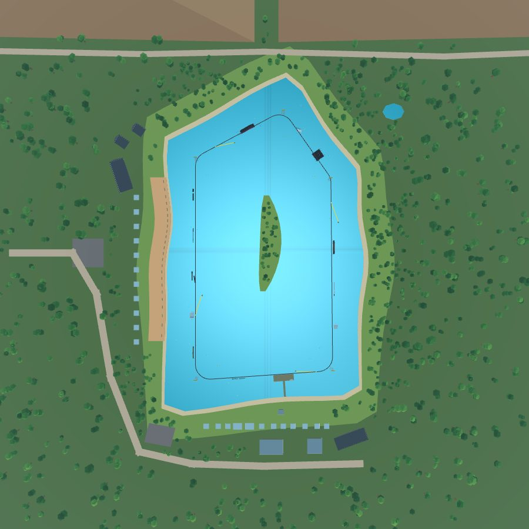
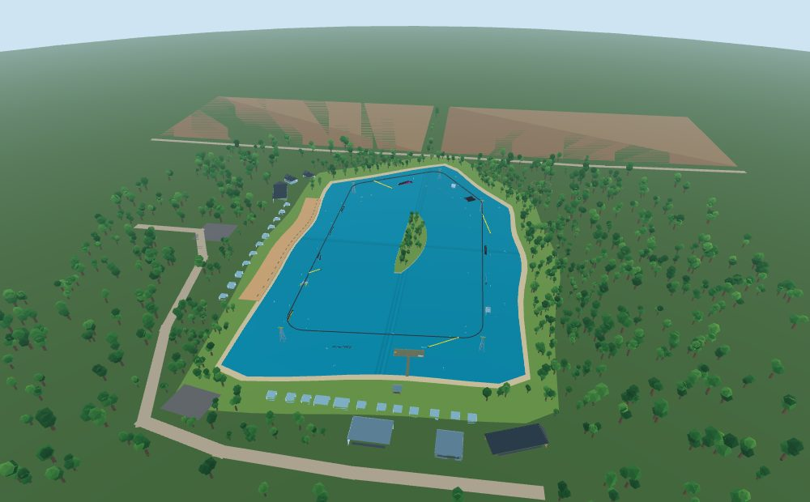
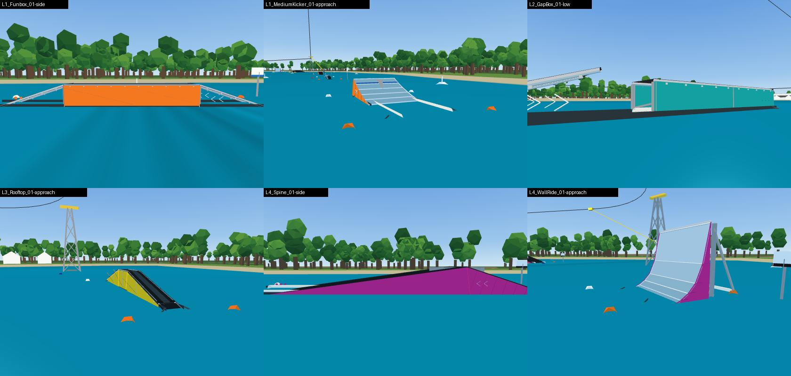

# Real wake park layout, clean-up, colours, buoys, towers

Report for the layout spec ("Real Wake Park Layout, Environment Clean-up,
Colours, Buoys, Towers"), one section per milestone.

## Milestone 1: audit and backup

### Backup

- The whole project before this spec is commit `7e2d804` on
  `claude/cable-wakeboard-foundation` (local tag `backup/pre-layout-2026-10-16`).
- In Studio, `ParkBuilder.backup()` clones `Workspace.Park` (the features) and
  `Workspace.WakePark` (towers, cable, site) into
  `ServerStorage/Backup_<YYYY-MM-DD>`. Run it from the server or the command bar
  before a rebuild; running it twice on the same day replaces that day's copy.
  `roblox/tests/park_build_spec.luau` checks it under the mock.

### How the park is made

Everything is generated from data, so the layout changes in data and rebuilds:

| What | Source | Built by |
|---|---|---|
| Features (ride data) | `src/sim/parkLayout.ts` → generated `Sim/ParkLayout.luau` | the sim's pieces (`featureShapes.ts`) |
| Feature models | the same defs | `ParkBuilder.buildPark` → `FeatureBuilder.build` |
| Web feature art | FeatureBuilder's parts, exported to `src/art/featureParts.json` | `BabylonRenderer.featureMesh` |
| Cable | `DEFAULT_CONFIG.cable.towers` (`config.ts`) | `cable.ts` `buildCablePath` |
| Towers | the same tower points | `WakeClient` (simple parts), `BabylonRenderer.buildPark` (lattice hulls) |
| Buoys | `site.buoys` + FeatureBuilder corner buoys + renderer extras | |

The rider's physics is the sim, not Roblox collision, so moving a feature
means moving its def (s, offset, yaw) and rebuilding; the model, ride parts
and crash volumes follow.

### Visual bugs (VisualAudit)

`roblox/src/shared/Park/VisualAudit.luau` scans built feature models;
`roblox/tests/visual_audit_spec.luau` runs it on both parks under the mock.
Counts before any change:

| Check | Wake park (12 features, 915 parts) | Beginner (3 features, 227 parts) |
|---|---|---|
| Z-fighting (same-facing coplanar overlapping faces) | 226 | 62 |
| Decals (SurfaceGui / Decal / Texture / SurfaceAppearance) | 36 | 12 |
| Transparency layering | 34 | 9 |
| Duplicates | 13 | 3 |
| Tiny clutter (< 0.25 studs) | 154 | 58 |
| Strays (outside a folder or far from the Root) | 0 | 0 |
| Broken assets (empty ids) | 0 | 0 |
| Stretched textures | 0 (no Texture instances) | 0 |

Z-fighting by part pair (both parks): TopSheet/WetBand 68, Chevron/Chevron 48,
Foam/WetBand 28, Foam/Foam 27, SignBoard/SignBand 15, TopSheet/Side 14,
TopSheet/Wear 13, TopSheet/Stripe 13, TopSheet/TopSheet 12, Side/WetBand 12,
EndPanel/EndPanel 8, Stripe/Wear 6, Side/TopSheet 6, Wear/Wear 4, Skirt/Skirt 4,
Side/Side 4, and single ones on the wall ride and rails.
Transparency: every Foam strip (0.35) over the top sheet.
Duplicates: the pipe rail's `Main2` sits exactly on `Pipe` (real); the other
15 are the paired invisible Approach / FX anchors at the Root.
Tiny: 212 bolt heads (0.14 studs).

Web view extras (not in the Roblox models): 20 random white "dome" buoys,
10 red/blue domes on the cable line itself, a rock mound at every tower base,
and FeatureBuilder's orange corner buoys, which read as flat orange shards
close up.

### Geometry

Towers (signed distance to the shore, + = in the water):
T0 (-56.2, 110.4) 26.5 m, T1 (56.2, 102.5) 22.9 m, T2 (54.7, -55.2) 22.9 m,
T3 (15.8, -110.4) 23.0 m, T4 (-56.2, -72) 25.1 m. All in the lake.

Straights and the room the layout rules leave (20-80 % band, 25 m after and
30 m before a corner):

| Straight | Length | Window | Room |
|---|---|---|---|
| South (dock) | 88.5 | 25.0-58.5 | 33.5 m, and the dock is at 51-68 |
| East | 142.7 | 28.5-112.7 | 84.1 m |
| North-east | 53.2 | - | none |
| North-west | 63.8 | 25.0-33.8 | 8.8 m |
| West | 162.3 | 32.5-129.9 | 97.4 m |

Lap test (no features, two laps): no input, the rider swings up to 12.4 m
inside the cable and stays 20.0 m from the shore; holding the outside edge,
11.3 m outside the cable and 8.8 m from the shore (west straight); holding the
inside edge, 16.2 m inside.

### Conflicts with the spec

1. The target layout (14 features on 5 straights) needs about 150-165 m for a
   three-feature straight (features + 30-40 m of run-out and approach between
   them + the corner zones) and about 115 m for S5 with the start dock. The
   loop has two such straights; it fits about 8 features.
2. Towers on land at least 8 m from the water would put the current
   straights on the shore, and the current lake already fails the 10 m
   swing margin for a rider carving out (8.8 m).
3. The beginner 2-tower system is inside the main loop, so its towers can
   only be in the water there.
4. Naming: S1 is the first straight after the start dock; the dock sits near
   the end of S5 so the 50-60 m clear zone runs through the corner into S1.
   Travel is counter-clockwise, so "outer" is right of travel.
5. No Studio connection: captures are from the web game (which draws the
   same exported parts); Luau runs under the mock.

Resolution (milestone 4): a new 5-tower loop with straights of about
115-165 m (about 815 m a lap), the lake grown east and north to hold it with
the towers on shore pads, the island kept in the middle out of the swing
zone, and a separate beginner lagoon east of the lake.
