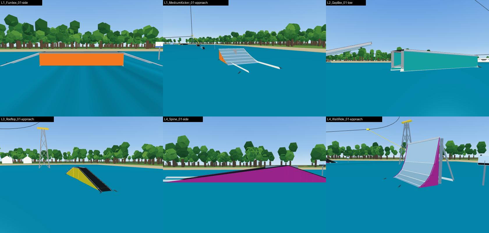
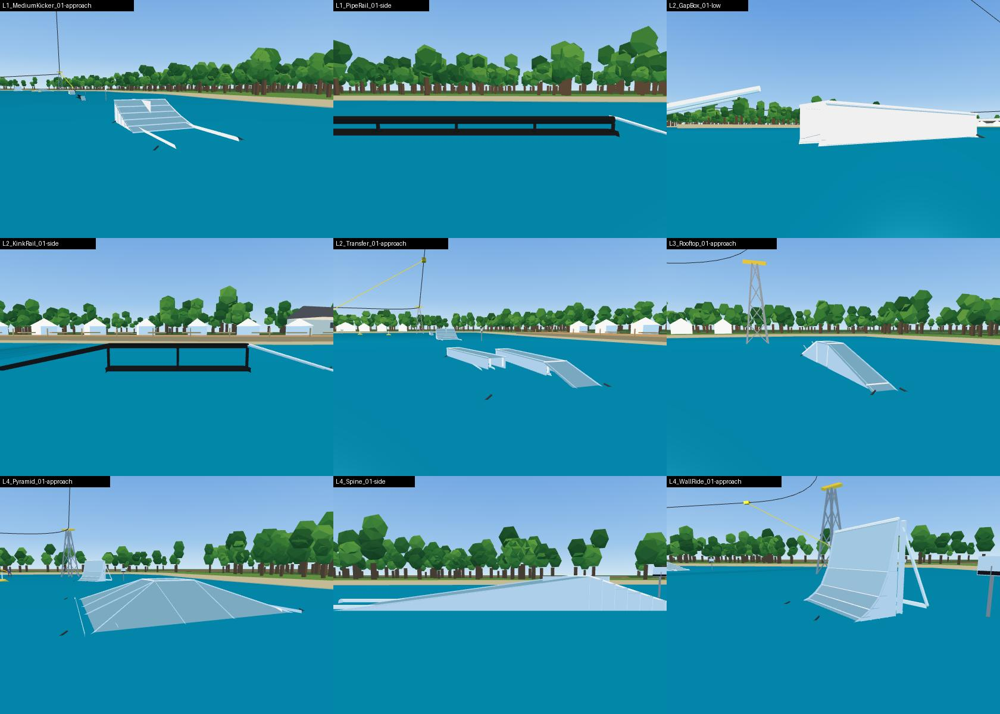
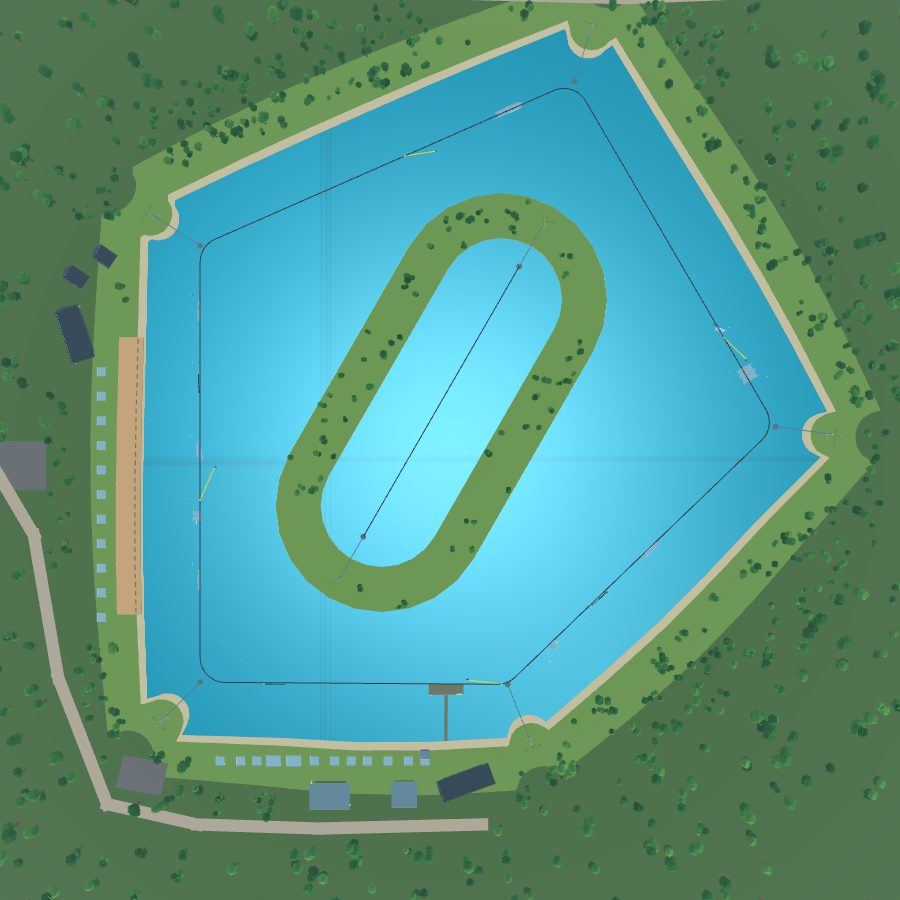
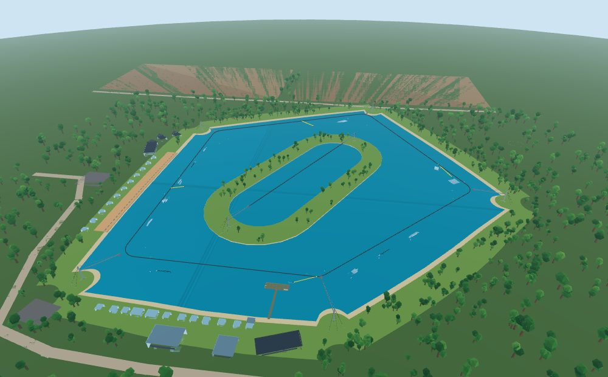
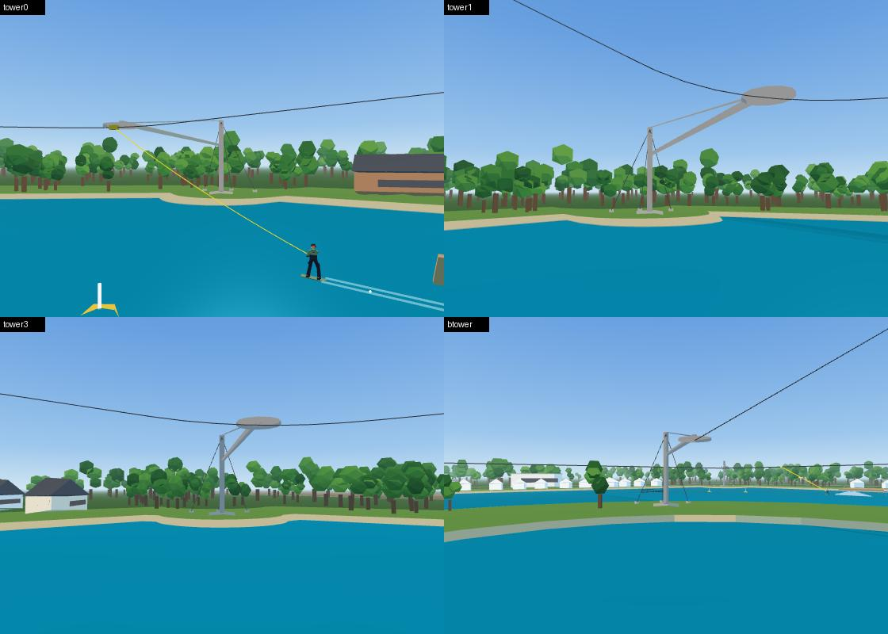

# Real wake park layout, clean-up, colours, buoys, towers

Report for the layout spec ("Real Wake Park Layout, Environment Clean-up,
Colours, Buoys, Towers"), one section per milestone.

## Milestone 1: audit and backup

### Backup

- The whole project before this spec is commit `7e2d804` on
  `claude/cable-wakeboard-foundation` (local tag `backup/pre-layout-2026-10-16`).
- In Studio, `ParkBuilder.backup()` clones `Workspace.Park` (the features) and
  `Workspace.WakePark` (towers, cable, site) into
  `ServerStorage/Backup_<YYYY-MM-DD>`. Run it from the server or the command bar
  before a rebuild; running it twice on the same day replaces that day's copy.
  `roblox/tests/park_build_spec.luau` checks it under the mock.

### How the park is made

Everything is generated from data, so the layout changes in data and rebuilds:

| What | Source | Built by |
|---|---|---|
| Features (ride data) | `src/sim/parkLayout.ts` → generated `Sim/ParkLayout.luau` | the sim's pieces (`featureShapes.ts`) |
| Feature models | the same defs | `ParkBuilder.buildPark` → `FeatureBuilder.build` |
| Web feature art | FeatureBuilder's parts, exported to `src/art/featureParts.json` | `BabylonRenderer.featureMesh` |
| Cable | `DEFAULT_CONFIG.cable.towers` (`config.ts`) | `cable.ts` `buildCablePath` |
| Towers | the same tower points | `WakeClient` (simple parts), `BabylonRenderer.buildPark` (lattice hulls) |
| Buoys | `site.buoys` + FeatureBuilder corner buoys + renderer extras | |

The rider's physics is the sim, not Roblox collision, so moving a feature
means moving its def (s, offset, yaw) and rebuilding; the model, ride parts
and crash volumes follow.

### Visual bugs (VisualAudit)

`roblox/src/shared/Park/VisualAudit.luau` scans built feature models;
`roblox/tests/visual_audit_spec.luau` runs it on both parks under the mock.
Counts before any change:

| Check | Wake park (12 features, 915 parts) | Beginner (3 features, 227 parts) |
|---|---|---|
| Z-fighting (same-facing coplanar overlapping faces) | 226 | 62 |
| Decals (SurfaceGui / Decal / Texture / SurfaceAppearance) | 36 | 12 |
| Transparency layering | 34 | 9 |
| Duplicates | 13 | 3 |
| Tiny clutter (< 0.25 studs) | 154 | 58 |
| Strays (outside a folder or far from the Root) | 0 | 0 |
| Broken assets (empty ids) | 0 | 0 |
| Stretched textures | 0 (no Texture instances) | 0 |

Z-fighting by part pair (both parks): TopSheet/WetBand 68, Chevron/Chevron 48,
Foam/WetBand 28, Foam/Foam 27, SignBoard/SignBand 15, TopSheet/Side 14,
TopSheet/Wear 13, TopSheet/Stripe 13, TopSheet/TopSheet 12, Side/WetBand 12,
EndPanel/EndPanel 8, Stripe/Wear 6, Side/TopSheet 6, Wear/Wear 4, Skirt/Skirt 4,
Side/Side 4, and single ones on the wall ride and rails.
Transparency: every Foam strip (0.35) over the top sheet.
Duplicates: the pipe rail's `Main2` sits exactly on `Pipe` (real); the other
15 are the paired invisible Approach / FX anchors at the Root.
Tiny: 212 bolt heads (0.14 studs).

Web view extras (not in the Roblox models): 20 random white "dome" buoys,
10 red/blue domes on the cable line itself, a rock mound at every tower base,
and FeatureBuilder's orange corner buoys, which read as flat orange shards
close up.


### Geometry

Towers (signed distance to the shore, + = in the water):
T0 (-56.2, 110.4) 26.5 m, T1 (56.2, 102.5) 22.9 m, T2 (54.7, -55.2) 22.9 m,
T3 (15.8, -110.4) 23.0 m, T4 (-56.2, -72) 25.1 m. All in the lake.

Straights and the room the layout rules leave (20-80 % band, 25 m after and
30 m before a corner):

| Straight | Length | Window | Room |
|---|---|---|---|
| South (dock) | 88.5 | 25.0-58.5 | 33.5 m, and the dock is at 51-68 |
| East | 142.7 | 28.5-112.7 | 84.1 m |
| North-east | 53.2 | - | none |
| North-west | 63.8 | 25.0-33.8 | 8.8 m |
| West | 162.3 | 32.5-129.9 | 97.4 m |

Lap test (no features, two laps): no input, the rider swings up to 12.4 m
inside the cable and stays 20.0 m from the shore; holding the outside edge,
11.3 m outside the cable and 8.8 m from the shore (west straight); holding the
inside edge, 16.2 m inside.

### Conflicts with the spec

1. The target layout (14 features on 5 straights) needs about 150-165 m for a
   three-feature straight (features + 30-40 m of run-out and approach between
   them + the corner zones) and about 115 m for S5 with the start dock. The
   loop has two such straights; it fits about 8 features.
2. Towers on land at least 8 m from the water would put the current
   straights on the shore, and the current lake already fails the 10 m
   swing margin for a rider carving out (8.8 m).
3. The beginner 2-tower system is inside the main loop, so its towers can
   only be in the water there.
4. Naming: S1 is the first straight after the start dock; the dock sits near
   the end of S5 so the 50-60 m clear zone runs through the corner into S1.
   Travel is counter-clockwise, so "outer" is right of travel.
5. No Studio connection: captures are from the web game (which draws the
   same exported parts); Luau runs under the mock.

Resolution (milestone 4): a new 5-tower loop with straights of about
115-165 m (about 815 m a lap), the lake grown east and north to hold it with
the towers on shore pads, the island kept in the middle out of the swing
zone, and a separate beginner lagoon east of the lake.

## Milestone 2: clean-up

FeatureBuilder changes (`roblox/src/shared/Park/FeatureBuilder.luau`):

- Removed: the SurfaceGui decals (park wordmark and line tags), chevrons, dot
  rows, difficulty stripes, wear strips, foam strips, wet bands, the algae
  tint under the water, bolt heads, and the corner buoys on every feature
  (buoys move to BuoyLayout in milestone 6). The anchor chains stay.
- Every visual surface that shows a ride surface (top sheets, the pipe, the
  coping, the wall face, the pyramid's faces) is sunk `FeatureConfig.VisualDrop`
  = 0.03 studs below it along its normal; never on or above it.
- Joints: consecutive stretches overlap at a kink, so every other stretch is
  5 mm narrower each side and no two share a side face. Side panels sit
  2.5-3.5 cm inside the top sheet's edge, frame legs and braces further in.
- Kicker skirts tile the area under the curve (an upright column and a wedge
  per segment) instead of overlapping slabs.
- The spine's landing slope shares the launch ramp's back wall (there were two
  in the same place); the rail web stops 1 cm short of the top sheet's ends;
  the pyramid's sheets are built in order so the narrow/wide alternation
  holds; the sign's difficulty band is inset from the board's edges.

Web renderer: the 20 random dome buoys, the 10 markers on the cable line and
the rock mounds at the tower bases are gone.

VisualAudit now also checks `onRide` (a visible face on, or less than 0.02
studs under, a ride surface, pointing the same way); with `VisualDrop` set to
0 it finds 62 + 15, so the check works. After the clean-up:

| Check | Wake park | Beginner |
|---|---|---|
| Parts | 915 → 540 | 227 → 118 |
| zFight / onRide / decals / transparent / duplicate / stray / brokenAsset / tiny | all 0 | all 0 |

`tests/featureModel.test.ts` now fails on any finding. The ride test (every
feature ridden with the Luau sim) and the validator pass unchanged: the ride
data was not touched.



## Milestone 3: colours (FeatureStyle)

One palette, `FeatureConfig.Style` (in `src/park/featureConfig.ts`, generated
to Luau; the web renderer reads the same table), applied by role through
`roblox/src/shared/Park/FeatureStyle.luau` (`apply(part, role)`, `color`,
`material`, `difficulty`, `allowed`). Every visible part records its role in a
`StyleRole` attribute.

| Role | Colour | Material | Reflectance | Used for |
|---|---|---|---|---|
| Feature | 240,240,240 | SmoothPlastic | 0.05 | kickers, boxes (slider, funbox, gap box, rooftop, transfer), wall ride, pyramid, spine: tops, sides, skirts, frames, coping, pontoons; the safety ramps in front of rails |
| Rail | 25,25,25 | SmoothPlastic | 0 | pipe rail, flat rail, flat-down rail, step-up rail slide surfaces |
| RailSupport | 25,25,25 | Metal | 0 | rail posts, feet, web |
| RailPontoon | 25,25,25 | SmoothPlastic | 0 | pontoons under rails |
| Chain | 60,60,62 | Metal | 0 | anchor chains |
| Tower | 150,150,150 | Metal | 0 | towers (milestone 4) |
| GuyWire / Foundation | 60,60,62 Metal / 170,168,160 Concrete | | 0 | towers (milestone 4) |
| SignPost / SignBoard | 150,150,150 Metal / 240,240,240 SmoothPlastic | | 0 | signs; the band shows the difficulty colour |
| BuoyBoundary / BuoyLane / BuoyBand / AnchorLine | 255,120,20 / 244,244,244 / 30,30,32 / 40,40,42 | SmoothPlastic | 0.1 / 0.1 / 0 / 0 | buoys (milestone 6) |

No underwater tint, no difficulty stripes, no line accent colours on the
features (the `Accent` attribute stays for the map), no decals or logos.
VisualAudit's `material` check now runs with `FeatureStyle.allowed()`: every
visible part of both parks uses a palette pair (0 findings).



## Milestone 4: towers on the shore, a new loop, the grown lake

The spec's rules (towers 8 m beyond reachable water, a 10 m swing margin,
features 12 m from shore, the target layout's 14 features) do not fit the
sketch lake, so the wake park gets a new loop and a lake grown east and
north to hold it. The west shore (watch terrace, clubhouse), the south shore
(beach tents, halls, lodge, parking) and the access road stay where they were;
the north fields and field road move 65 m north, the small pond 190 m east.
The sketch, test and catalogue maps keep the old lake and towers
(`DEFAULT_CONFIG.cable`); the wake and beginner parks carry their own `cable`.

**Loop** (`WAKE_CABLE` in `src/sim/parkLayout.ts`, counter-clockwise, 911.6 m a lap):

| Straight | From tower | Length | Heading |
|---|---|---|---|
| S1 | T0 (92, 111) | 164.6 m | north-east |
| S2 | T1 (221, -13) | 172.1 m | north-west |
| S3 | T2 (124, -179) | 178.0 m | south-west |
| S4 | T3 (-56, -100) | 190.2 m | south (west side) |
| S5 | T4 (-56, 110) | 131.2 m | east (south side), start dock at 98-115 m |

Corners turn 45-89 degrees (cornerRadius 12). The loop came from a search
over five tower positions for the smallest lake that gives each straight the
length its target features need (S1 153, S2 163, S3 168, S4 181 m, S5 about
115 m with the dock; computed from the catalogue's real feature lengths) with
no corner sharper than 95 degrees.

**Lake** (`shoreFor`): rays from the loop's centre stop at a shore line 28 m
outside the cable (bowed out up to 3 m between towers) or at a tower's
headland (a 10.5 m disk round its base), so the outline is star-shaped by
construction (the land ring and forest need it) and each headland's neck is
the land behind its head. 84,000 m2, 331 by 347 m (the sketch lake: 166 by 280 m).

**Towers** (`towerSites`, `src/art/tower.ts`, `roblox/src/shared/Park/TowerBuilder.luau`):
each mast stands on land on its corner's outward bisector, `WAKE_TOWER_ARMS`
= 30 / 27 / 27 / 28 / 26 m back from the cable corner, and a boom with a tie
carries the carrier wheel out to where the cable passes (the middle of the
corner arc). Low-poly grey steel (FeatureStyle `Tower`), a concrete
foundation (`Foundation`), three guy wires (`GuyWire`) to anchors further
inland. CanCollide, CanQuery and CanTouch are off; tag `CableTower`. The arms
are long because riders pass within a few metres of a cable corner (on the
approach the rider is still on the line when the carrier turns): with 8 m of
land beyond the water and 10 m of water beyond the rider, the mast has to
stand about 21 m from the rider's closest pass. They were solved from the
rider's envelope (no input and weaving edge to edge every 1-3 s, from five
starts round the loop).

**Beginner line**: its own 150 m 2-tower cable, (22.5, 40) to (97.5, -90),
in a lagoon 60 m wide inside a ring island (22 m of land) in the middle of the
loop, 29 m or more from the main cable. Both towers stand on the island,
24 m beyond the line's ends (the shuttle rider runs nearly to the far tower).

**Lap test** (`scripts/lapTest.ts`, `npx vite-node scripts/probe-lap-shore.ts`,
checked by `tests/tower.test.ts`): no features, four riders. Closest approach
to any shore (lake or island) and to a tower base:

```
Lakeside Wake
  none         min shore 22.6 m   per tower 22.6 / 22.9 / 23.9 / 22.7 / 23.8   rider to base 33.1 / 33.4 / 34.4 / 33.2 / 34.3
  weave 1.2 s  min shore 13.7 m   per tower 14.0 / 14.9 / 16.8 / 18.5 / 13.7   rider to base 24.5 / 25.3 / 27.3 / 31.6 / 24.2
  weave 1.6 s  min shore 11.4 m   per tower 14.0 / 14.3 / 11.4 / 18.0 / 12.7   rider to base 24.5 / 24.8 / 21.9 / 40.2 / 23.2
  weave 2.4 s  min shore 10.9 m   per tower 10.9 / 11.9 / 11.4 / 17.2 / 12.2   rider to base 21.4 / 22.4 / 21.9 / 27.6 / 22.7
Beginner line
  none         min shore 16.9 m   per tower 16.9 / 16.9   rider to base 27.5 / 27.5
  weave 1.2 s  min shore 10.6 m   per tower 10.6 / 13.2   rider to base 30.2 / 27.4
  weave 1.6 s  min shore 10.4 m   per tower 10.4 / 16.3   rider to base 30.2 / 28.4
  weave 2.4 s  min shore 10.7 m   per tower 10.9 / 10.7   rider to base 30.2 / 28.4
```

No crashes. Every tower base is 10.3 m or more from water (8 m + the
foundation). Holding one edge for a whole lap (not a riding line) still
reaches past the margin; that is the rope, not the corner.

The milestone keeps the features spec's lines, moved round with the
straights (milestone 5 re-lays them). The parity test now runs 20,000 ticks
(a lap is 110 s).




