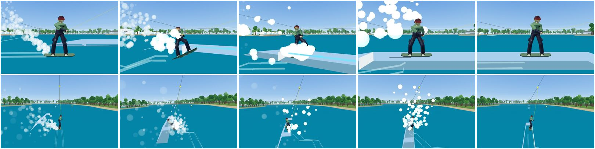
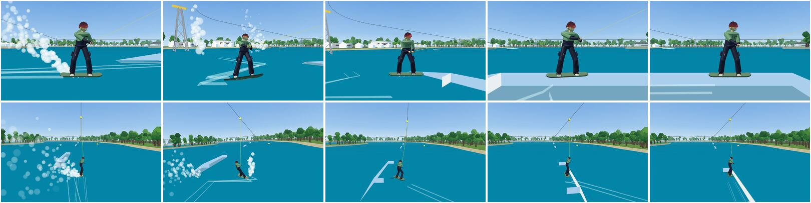
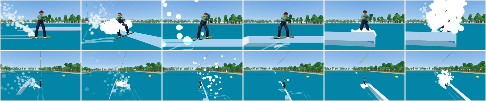
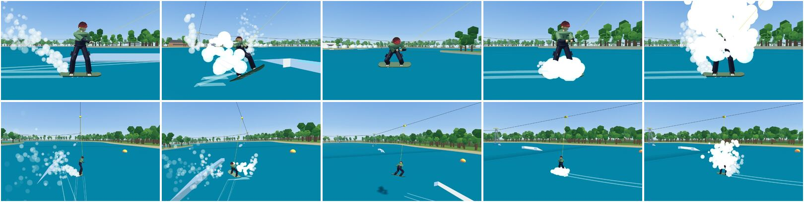
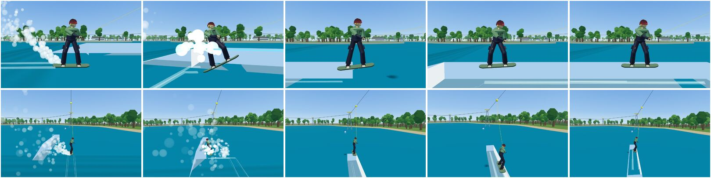
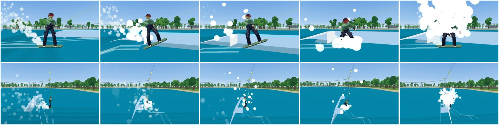

# Side approach v2: edge, ollie, slide-on, and a wider margin of error

The "Side Approach v2 (Edge, Ollie, Slide-On) and a Much Wider Margin of
Error" spec, on top of the slide-on (docs/SLIDE_ON.md). A side approach is
now one move: an edge cut toward the feature, an ollie popped off that edge,
then the slide-on. Every side approach ends in exactly one outcome, A to F.
Only F is a crash. All the numbers are in `SlideOnConfig`
(`src/sim/featureRide/slideOnConfig.ts`); the Luau twin matches it bit for
bit (parity test).

- Sweep: `npx vite-node scripts/side-approach-sweep.ts [--fails] [--json out.json]`
  (harness: `tests/scenarios/sideApproachSweep.ts`).
- Scenarios: `npx vite-node scripts/slide-on-report.ts`
  (`tests/scenarios/slideOnScenarios.ts`, tested in `tests/slideOnScenarios.test.ts`).
- Practice park: `?park=side` (the sweep's features, 3 m off the cable line).

## Space held into the side: auto pop and a sideways landing

Added after the v2 report: carving into a feature's side with Space held
(never released) used to reach the side still on the water and crash.

- **Auto pop** (`autoPopDue`, `SlideOn.AutoPop`): while Space is held beside
  a feature, the pop goes off on its own. A charge whose arc clears the top
  pops when it will come back down to the top over the feature's centre line
  (an air-on). A lower one pops when its arc peaks as the nose reaches the
  edge (a slide-on). Cutting into a safety ramp's side, it pops for the ramp.
  Coyote time (the pop at the edge, 5% lower) stays as the last chance.
- **Sideways landing** (`startSideTurn`): an auto pop from 8° of turn-in or
  more (`SideTurnAngle`) turns the board on to 90° to the feature in the
  air (`SideTurnRate`, 450°/s), so it lands across the feature in a
  boardslide. A/D in the air cancels it (your own spin). A pop you release by
  hand keeps the v2 behaviour; `SideTurnManualAngle` (default 0, off) turns
  it on for those too.
- **No crash from the turn:**
  - If the arc will come down in the water instead of on a top (sampled
    every 1/30 s, `SideTurnReach` 0.45 m), the board turns back in line for
    the water (`stepSideTurnBack`). It also turns back if it flies over the
    feature.
  - A slide the game turned sideways (`jib.autoSideways`) turns out by
    itself off the end (a 90 out), and riding it down into the water does
    not catch.
  - A pop from beside a feature lines up into a slide (`alignSlide`) even
    across the main's front edge.
- **Tests:**
  - `tests/slideOn.test.ts` holds Space into the side on both sides: it pops
    on its own, lands in a boardslide, no crash.
  - The parity entry scenario "auto pop, sideways".
  - The sweep below times its own releases, so it runs with `AutoPop` off.
- **On the wake park:**
  - Held into the Slider, Gap box, Flat rail and Pipe rail from 6-12 m, it
    lands sideways in most runs.
  - What still crashes: weak pops (Space held for only the last 3 m) as
    `noseDig`, and the boardslide's own fore/aft balance on a down-sloping
    exit ramp (the Funbox) as `fellOffFeature`. W/S corrects that, as on any
    boardslide.

## Results

The same harness and the same 13,824-run grid (spec 6.1: 8 angles × 4
distances × 4 charges × 3 edges × W on/off × 3 pop timings, on 6 reference
features), on the code before this change (commit 3b8e8e7) and after it.
The full outputs are `side-approach-v2/sweep-before.txt` and `sweep-after.txt`.

| Feature | A+B before | A+B after | No crash before | No crash after |
| --- | --- | --- | --- | --- |
| table 0.30 | 5% | 68% | 8% | 87% |
| box 0.50 | 4% | 70% | 5% | 87% |
| ledge 0.80 | 0% | 62% | 0% | 79% |
| pipe 0.63 | 1% | 69% | 6% | 88% |
| kanted 0.65 | 1% | 61% | 6% | 86% |
| rail 0.60 | 0% | 54% | 8% | 88% |
| all | 2% | 64% | 6% | 86% |

"No crash" counts A to E. The rest of the grid is N: the board comes back
down in the water on the near side without touching the feature (1,798
runs, mostly the 0° runs parallel to the feature and turn-ins past 75°).

Section 5 targets, after:

| Target | Result |
| --- | --- |
| Roughly right (10-45°, 0.3-2.5 m, charge ≥ 0.5), features ≤ 0.65 m: ≥ 90% A/B | 95% (before 6%) |
| Roughly right, 0.80 m ledge with W: ≥ 80% | 96% (before 2%) |
| Steep (45-75°): no F caused by angle | 33 F of 5,184, all charge-0.25 pops on the 0.80 m ledge (the same pops fail at 10-20°). 57% B/C/D, the rest A |
| Low effort (charge 0.25 on the table): ≥ 85% A | 90% (before 14%) |
| Sloppy timing (+0.15 s): drop ≤ 10 points | 0 points |
| Clearly bad (charge 0.1 on the ledge, no W): mostly F | 83% F (36 runs: 10-45°, 0.3-2 m, any edge) |
| Reachable heights: ~0.90 m auto lift, ~1.05 m W, ~0.70 m air-on | 0.93 m, 1.06 m, 0.66 m (calculator, full charge, flat board); a full edge adds about 0.3 m |

Crash reasons, before → after:

| Reason | Before | After |
| --- | --- | --- |
| `noseDig` | 5,189 | 153 (all clearly short: weak pops on the 0.80 m ledge and a few on the rail and kanted box) |
| `hitFeature` | 1,764 | 0 |
| `overRotated` (W flipped the board beside the feature) | 1,628 | 0 |
| `clippedSide` | 1,470 | 0 |
| `slippedOut` | 754 | 0 |
| `noseHitSide` | 697 | 0 |
| `overshoot` | 242 | 0 |
| `shortOllie` | 62 | 0 |
| `hangUp` | 53 | 0 |

The before run used the after harness. Two settings were given to the old
code so the scripted rider could pop at all: the approach tracker's 12 m
range and 0.1 m front margin. The old code's grid harness also had no edge
release, so the old pop ignored the edge.

## Scenarios (spec 6.2)

| # | Scenario | Wanted | Result |
| --- | --- | --- | --- |
| 1 | Heelside edge, 20°, charge 0.5, table 0.30 | A `Slide-on 50-50` | A: Slide-on 50-50, 0.35 s air |
| 2 | Toeside edge, 25°, charge 0.75, box 0.50 | A | A: Slide-on 50-50 |
| 3 | Heelside, full edge, 45°, charge 1.0, box 0.50 | B `Side Ollie-on 50-50`, extra air | B: Side Ollie-on 50-50, 0.75 s air |
| 4 | As 3 with a 90 in the air | B `Backside ... Boardslide` | B: Side Ollie-on Backside Boardslide |
| 5 | 70°, full charge, narrow box | D `Ollie Over` | D: Ollie Over, 1.58 s air |
| 6 | 60°, medium charge, narrow box, no counter-steer | C | C: slides off the far side, lands rideable |
| 7 | As 6 with counter-steer | A | A: stays on top |
| 8 | Ledge 0.80, W, charge 0.75, 20° | A | A |
| 9 | Full edge at the pop | never SlippedOut | A |
| 10 | Ledge 0.80, charge 0.1, no W | F `NoseDig` | F: noseDig |

Scenarios 3 to 5 start their cut 4 to 6 m off the side. Closer in, a 45° cut
does not have the time in the air to clear the box.

## What changed

### 1. Edge to pop (spec 1.1)

- `edgeLoadAt(s)`: the edge (0..1) if it carves toward the feature, times
  the rope tension over `EdgeTensionRef` (1,000 N), clamped to 0.3..1.5.
- The pop gets `EdgePopBonus` × load upward. The edge's release gets
  `EdgeReleaseBonus` (0.8 m/s) × load toward the feature.
- `SlippedOut` is gone for side approaches: only a front approach slips.
- While a side approach is on, a water trick does not arm, so the loaded
  edge is the edge ollie, not a raley.
- Coyote time: charging into the side, the pop goes off by itself when the
  nose reaches the edge, `CoyotePenalty` (5%) lower.

### 2. The checks (spec 2): each check, before and after

| Check | Before | After |
| --- | --- | --- |
| Turn-in window | 6-32° | 0-75° (`MinAngle`, `MaxAngle`); past 75° the physics still decides |
| Head-on nose dig | over 35° off the axis | removed |
| Distance off the side | 0.2-2.8 m | 0-4 m (`MinLateral`, `MaxLateral`) |
| Feature left after contact | 2.0 m | 1.2 m (`MinRemaining`) |
| Nose clearance at the edge | must clear the top | `NoseTolerance` below the top: Rounded 0.12, Coping 0.08, Round/Kanted 0.18, Rail 0.04, Bank 0.3 m |
| Nose low | NoseDig | scrape-up within `ScrapeBand` (0.15 m) below the tolerance, 12% slower; deeper digs in only if the board cannot climb the face (it is not rising enough and its inward speed would lift it less than `InwardClimbMax`, 0.4 m) |
| Thin rail | its own hang-up rule | the ordinary climb with a small tolerance |
| Climb | 85% of the inward energy, rope as is | 95% (`ClimbEfficiency`), rope help × 2 (`RopeAssistScale`) |
| Hang-up | out of inward speed: crash | only below 0.5 m/s with the board's middle more than 0.25 m low; at least 50% of the board on top is a save (E), else the board drops back into the water (not a crash) |
| Yaw on contact | sketchy past 20°, BadAngle past 70° | `alignSlide`: to 35° a clean 50-50, to 60° a 50-50 with a balance hit, 60-120° the nearest 90° slide; never a crash |
| Side crossing low (no slide-on) | `clippedSide` past 0.10 m | the scrape-up allowance; deeper is `noseDig` |
| Side crossing over 25° (no slide-on) | `noseHitSide` | removed |
| Carry past the far side | `overshoot` | slides off into the water (C); counter-steer bleeds 75% per 0.1 s |
| Down low past the far edge | `overshoot` | over the feature (D) |
| Landed outside the balance width from the side | `clippedSide` / `overshoot` | sketchy, a balance hit |
| W beside a feature | could flip (`overRotated` on landing) | lifts the nose, never flips |

### 3. Outcomes (spec 3)

- **A Slide-on**: nose over, base slides on.
- **B Air-on**: `Side Ollie-on`, with an `Air` bonus of `AirOnBonus` (60) points per second of air.
- **C Slide-off**: the carry takes it off the far side. The exit is `slideOff` and the water landing uses the normal rules.
- **D Jump-over**: named `<air> Over` (`Ollie Over`, `Frontside 360 Over`), worth +40. A brush within `TapHeight` (0.12 m) of the top on the way is a `Tap`, worth +15. The sweep's arcs pass at least 8 cm over the top, so taps are rare.
- **E Save**: sketchy, with a big wobble.
- **F Fail**: only a clear `noseDig`, or a crash volume.

### 4. Animation and effects (spec 4)

- **Animation phases.** `RiderAnimState.ext.slideOn` gets new phases:
  - `Edge`: the edge cut, weighted by the edge load.
  - `AirOn`: air-on or jump-over air.
  - `SlideOff`.
  - `Save`.

  They are appended to the replicated list, so the packet keeps its layout (53 values).
- **Clips:**
  - `edgeCut`: hips over the edge, knees 48-52°, handle low and in. The shoulders open toward the feature heelside and turn away toeside (`EdgeTwist`).
  - `sideAir`: the pop with the front knee driving up, a tuck scaled by the air time (`AirTuck`), then the legs reach for the landing.
  - `slideOff`: lean back toward the feature, let go, absorb.

  Each clip cross-fades on its own spring. A save adds a fading wobble (`SaveWobble`, `SaveHz`).
- **Effects, web and Roblox:**
  - More spray off an edge cut into a feature (`EdgeSpray`).
  - A burst at the pop (`PopSpray`).
  - The scrape on contact (as before).
  - A tap sound (`TapVolume`, `Sound.Tap`).
  - A bigger splash landing off a slide-off or a jump-over (`OutcomeSplash`).
- **Not done:** the head aim and the free-arm windmill on a save. The existing feature balance windmill already shows on a big balance hit.

### 5. Captures (spec 6.3)

The sweep's scripted rider is replayed tick by tick in the web build on
`?park=side`. The game's slow motion is on, with one sim tick per frame. The
top row of each sheet is from the side (toe side, `?cam=front`), the bottom
row from behind (chase camera). Left to right: the edge cut, the pop, the top
of the arc, contact, then the outcome.

| | |
| --- | --- |
| A Slide-on  | B Air-on  |
| C Slide-off  | D Jump-over  |
| E Save  | F NoseDig  |

## Changed config values

| Value | Before | After |
| --- | --- | --- |
| `SidePopScale` | 0.537 | 0.586 (a flat full-charge side ollie clears about 0.70 m) |
| `NoseLiftTime` | 0.12 s | 0.05 s |
| `MinAngle` / `MaxAngle` | 6° / 32° | 0° / 75° |
| `MinLateral` / `MaxLateral` | 0.2 / 2.8 m | 0 / 4.0 m |
| `MinRemaining` | 2.0 m | 1.2 m |
| `ClimbEfficiency` | 0.85 | 0.95 |
| `SketchySaveShare` | 0.7 | 0.5 |
| `CounterSteerBleed` | 0.5 | 0.75 |
| `featureRide.Approach.LateralRange` | 8 m | 12 m |
| `featureRide.Approach.FrontMargin` | 0.3 m | 0.1 m (alongside a feature is always a side approach) |
| Removed | | `HeadOnAngle`, `SketchyAngle`, `BadAngle` |
| New | | `EdgePopBonus` 0.7, `EdgeReleaseBonus` 0.8, `EdgeTensionRef` 1000, `EdgeTensionMin` 0.3, `EdgeTensionMax` 1.5, `NoseTolerance`, `ScrapeBand` 0.15, `ScrapeSpeedLoss` 0.12, `InwardClimbMax` 0.4, `RopeAssistScale` 2, `HangUpSpeed` 0.5, `HangUpDrop` 0.25, `CarryAbsorb` 6, `LandingCarryAbsorb` 9, `AlignClean` 35°, `AlignHit` 60°, `AlignHitAmount` 0.4, `EdgeLeadAngle` 60°, `CoyotePenalty` 0.05, `AirOnBonus` 60, `TapHeight` 0.12 |

`featureRide.SideEntry.OvershootCatch` stays in the config but is no longer
used.

## Decisions (where the game differs from the spec)

1. **`EdgePopBonus` is 0.7, not 1.2.** The bonus applies to the side pop, which is
   already scaled to the side height. At 1.2, a full edge put every 45° pop
   over a 0.5 m box (D instead of B), and the reachable height went past
   1.3 m.
2. **`CounterSteerBleed` is 0.75 per 0.1 s, not 0.5.** At 0.5, scenario 7
   still slid off the narrow box.
3. **The legs absorb part of the inward speed.** That is `CarryAbsorb`, 6 m/s on a
   slide-on and 9 m/s on an air-on landing; only what is left carries the
   board across. Without it, nearly every 30° slide-on slid off the far side.
4. **The board settles on the near half of the balance width**, not on the
   edge.
5. **The nose-dig rule uses energy.** The spec says to dig in when the board is
   "mostly below the top". The game asks whether the board can still climb the
   face: either it is still rising, or its inward speed lifts it up to
   `InwardClimbMax`. Without the cap, a 0.1-charge pop at 45° climbed the
   0.80 m ledge on inward speed alone.
6. **A scrape-up is sketchy only when it nearly stalls** (deep and below
   1 m/s inward). A scrape within the band is clean but 12% slower.
7. **A held counter-steer does not start a rotation.** A/D held against
   the carry starts no 90° rotation until it is released
   (`jib.counterHeld`). Otherwise the counter-steer that saved the
   slide-on spun the board into a dropped handle.
8. **A low side crossing with no slide-on scrapes up onto the top.** This
   covers the side of a flush safety ramp near its top.
9. **The thin rail climbs like any other edge.** Its small nose tolerance
   (0.04 m) replaces the old rule that the board's middle had to clear it.
10. **Taps are rare.** The board is a point in the sim. An arc closer than
    about 8 cm comes down on the top and lands, so only the closest passes
    count as a brush.
