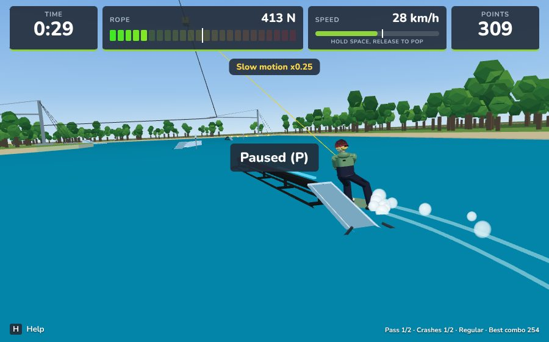
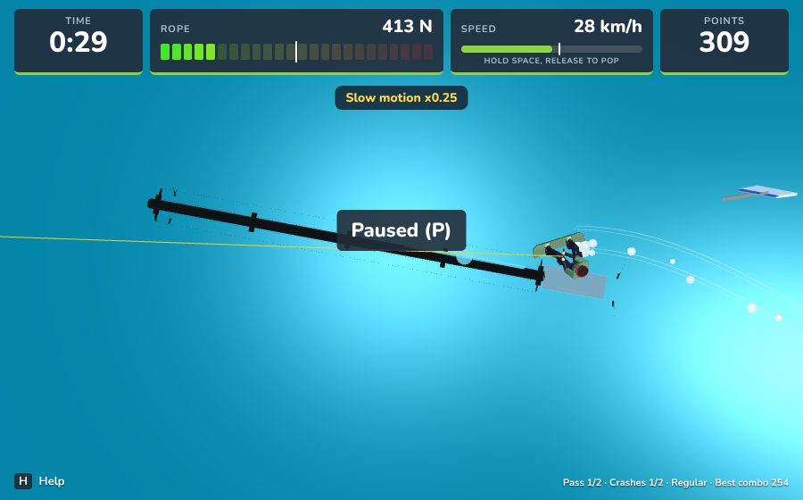

# Side approaches: the slide-on

The "Side Approaches Re-imagined (Ollie + Nose-Lift Slide-On)" spec. A side
entry no longer needs the whole board to clear the top. The rider lifts the
nose over the side edge and the base slides up and over it. The numbers are
in `SlideOnConfig` (`src/sim/featureRide/slideOnConfig.ts`,
`DEFAULT_CONFIG.slideOn`; Luau twin `Sim/FeatureRideSlideOnConfig.luau`).

## Reachable heights (spec 4.3, 8.1)

`SlideOnConfig.maxReachableHeight(cfg, charge, noseLift, sideType?, speed?, angle?)`.
Print the table with `npx vite-node scripts/slide-on-table.ts`.

Top height above the water a side entry reaches, at 8.3 m/s with a 20 degree turn-in:

| Charge | Plain side ollie (0 deg) | Slide-on, auto lift 18 deg | Slide-on, W 30 deg | Thin rail | Pipe (18 deg) |
|---|---|---|---|---|---|
| 0 | 0.10 m | 0.37 m | 0.50 m | 0.20 m | 0.37 m |
| 0.25 | 0.19 m | 0.45 m | 0.59 m | 0.29 m | 0.45 m |
| 0.5 | 0.29 m | 0.55 m | 0.69 m | 0.39 m | 0.55 m |
| 0.75 | 0.41 m | 0.67 m | 0.81 m | 0.51 m | 0.67 m |
| 1 | 0.54 m | 0.81 m | 0.94 m | 0.64 m | 0.81 m |

Full charge, 18 degree lift, by turn-in angle:
6 deg: 0.64 m, 10 deg: 0.70 m, 15 deg: 0.81 m, 20 deg: 0.81 m, 25 deg: 0.81 m, 32 deg: 0.81 m

How the calculator works:
- *The pop*: a side-entry pop is the ollie at `SidePopScale` (0.537), so it
  peaks at 0.18 m with no charge and 0.62 m with full charge.
- *Plain side ollie*: the board has to clear the top by `Entry.Clearance`
  (0.08 m).
- *Slide-on*:
  - The nose has to clear the edge by `NoseClearance` (0.03 m, +0.02 m on
    coping). The nose sits half a board (0.7 m) x sin(lift) above the
    board's middle.
  - The rider then climbs from the board's middle up to the top. The budget
    is the inward kinetic energy x `ClimbEfficiency` (0.85) minus the
    edge's scrape (`EdgeFriction`), plus any upward speed left at contact.
- *Thin rails*: the board's middle has to pass over the rail.
- *Round sides*: they start the climb 0.15 m lower.

## Approach tracking and availability (spec 3)

`ApproachTracker` reads each approach, and `featureRide/slideOn.ts`
(`assessSlideOn`) decides whether a slide-on is possible. They give:
- the turn-in toward the feature (`approach.turnIn`, signed) and the
  inward speed;
- where the board will meet the side edge (`contactU`), with the top height,
  edge type and radius there, and the main left after it;
- the highest top this approach can reach (the calculator at the current
  speed and turn-in, full charge, full lift);
- `slideOnBlock`: '' when a slide-on is possible, otherwise why not.

| Check | Default | Block |
|---|---|---|
| Side approach | not dead ahead | `front` |
| Within `TrackRange` of the start | 20 m | `range` |
| Turn-in toward the feature | 6-32 deg | `angle` |
| Off the side | 0.2-2.8 m | `distance` |
| A top at the contact point | | `noTop` |
| No wall over 0.3 m above the top (`sideWall`, or a wall piece) | | `wall` |
| Top no higher than the reachable height | | `height` |
| Main left after contact | 2.0 m | `end` |

Edge types come from the ride data, or from the feature def's `sideType`:
- a round profile is `Round`;
- a flat top narrower than 0.35 m is a thin `Rail`;
- a feature with side faces (the pyramid) is `Bank`;
- wall pieces are `Wall`;
- any other flat top is `Rounded` (the validator's 0.04 m coping radius).

`Coping` and `Kanted` exist only by a def's `sideType` (the catalogue has no
metal-edged ledge).

**Approach cue.** While a slide-on is possible, the side edge on the rider's
side glows soft cyan for 3 m around the contact point, and a disc marks the
contact point. F9 toggles it in the web game, F9 in the Roblox client too.
There is no tutorial yet, so it is on by default.

| | |
|---|---|
|  Turned in toward the pipe rail: the near edge glows |  From above: the contact marker on the edge |

## Physics (spec 4.1-4.2)

Code: `src/sim/featureRide/slideOn.ts` (the maths), `onFeature.ts`
(`stepSlideOnContact`, `mountSlideOn`, `stepSlideOnCarry`) and the hooks in
`step.ts`. The Luau twins have the same names.

1. **Pop.** A water pop with a tryable approach starts `air.slideOn`. A
   tryable approach is one with no block, or blocked only by `height`, by
   `end`, or by an `angle` steeper than MaxAngle. The pop keeps
   `SidePopScale` of its vertical speed.
2. **Air.** The nose lifts to `AutoNoseLift` in `NoseLiftTime`. W within
   `WWindow` of the release raises the target to `MaxNoseLift`. While the
   slide-on is in the air, W never flips the board.
3. **Lead crossing.** When the leading point passes over the near side
   edge, the checks run in this order:
   - Nose ahead, more than `HeadOnAngle` off the axis: `noseDig`. Banks are
     exempt.
   - The low end of the board clears the top by `Entry.Clearance`: it is a
     plain side ollie and flies on (`sideOllieOn` as before).
   - Thin rails: the nose must clear, then the board's middle must reach the
     rail, else `hangUp`.
   - Other edges: the nose must clear the edge by `NoseClearance` (coping
     needs more), else `noseDig`.
   - Otherwise the contact phase starts.
   If the board turned near 90° in the air, the edge leads instead of the
   nose; that is an Edge Slide-on.
4. **Contact.** Each tick runs `SubSteps` sub-steps. The board's middle climbs
   from its height at contact to the top. The upward speed left at contact
   pays for the climb first. After that the inward kinetic energy pays
   (× `ClimbEfficiency`), less the edge's scrape (`EdgeFriction`), and the
   rope's inward pull helps. Meanwhile the nose comes down flat.
   - With the tail on top, the board mounts.
   - Out of inward speed, the board hangs up on the edge. With
     `SketchySaveShare` or more of the board on top it is a sketchy save
     (balance hit `SketchySaveHit`). With less, it is a `hangUp` crash.
5. **Mount.**
   - The board snaps to the nearest slide angle: 0 or 180°, or ±90° for an
     edge lead.
   - A/D straightens it by up to `YawCorrection`.
   - Off by more than `SketchyAngle` is sketchy; more than `BadAngle` is a
     crash. A hard edge still on at takeoff is checked the same way as on
     other entries (`slippedOut`).
   - The board loses `SpeedLoss` of its forward speed.
   - The entry is `slideOn` or `edgeSlideOn`. It is clean when it keeps
     `CleanInwardShare` of its inward speed and is not sketchy.
6. **Overshoot.** The inward speed left keeps carrying the board across.
   - The base bites: the speed bleeds at `InwardFriction` × g.
   - Counter-steer (A/D away from the way the board is going) bleeds
     `CounterSteerBleed` per 0.1 s. While it carries, A/D does not rotate the
     board.
   - Passing the far side of the balance width within `OvershootWindow` is
     `overshoot`.

Example outcomes on a 1 m wide box (tests/slideOn.test.ts):

| Line | Result |
| --- | --- |
| 0.5 m, 15° in, pop released 1.0 m off the side | clean Slide-on 50-50 |
| 0.8 m, 18° in, W | Slide-on, nose at 30° |
| 0.8 m, 18° in, no W | NoseDig |
| 0.8 m, 15° in, W, released 1.2 m off | HangUp |
| 0.8 m, 15° in, W, released 1.0 m off | sketchy save |
| 0.5 m, 20° in, released 0.4 m off | NoseDig (nose still low) |
| 0.5 m, 25° in | Overshoot; counter-steer saves it |

## Names and scoring (spec 6)

- **Entry words.** `Slide-on` and `Edge Slide-on`. An Edge Slide-on comes
  after its slide's side: `Backside Edge Slide-on Boardslide`,
  `Frontside Edge Slide-on Switch Lipslide`. Other examples:
  `Slide-on 50-50`, `Slide-on Switch 50-50 180-out`. Both sims have these
  in the namer parity cases.
- **Entry bonus** (`Scoring.EntryBonus`):

  | Entry | Bonus |
  | --- | --- |
  | `sideOllieOn` (clears the whole board) | 80 |
  | `edgeSlideOn` | 60 |
  | `slideOn` | 50 |

- **Clean bonus.** A clean slide-on adds `Clean Slide-on`
  (`SlideOnCleanBonus` 15 × difficulty). Clean means it kept
  `CleanInwardShare` of its inward speed and was not sketchy. Even with the
  bonus, both slide-ons score less than a whole-board side ollie-on.
- **Sketchy entries.** A sketchy save, a sketchy angle or a sketchy roll
  marks the jib sketchy. The line's quality is then multiplied by
  `safety.sketchyMultiplier`, and the entry quality by 0.6.

## Edge cases (spec 7)

- **Sloped parts.** The climb aims at the top's height where the lead
  crosses, and the mount follows the slope. For example, a slide-on onto
  the Rooftop's down slope works.
- **Near the end.** With less than `MinRemaining` left, the cue is off, but
  the rider can still try. A board that slides on past the end of the top
  flies on off it.
- **Multi-lane features.** The lane nearest the board is used: for the
  approach, at the lead crossing and at the mount. On the Transfer, each
  side slides onto its own lane.
- **Switch and goofy riders.** Toe and heel sides come from the stance, the
  same as other side entries.
- **Contact angles.** 20–70° is sketchy. Beyond 70° is `badAngle`, except
  near 90° (the edge-lead snap).

## Animation, effects and camera (spec 5)

- **Board.** `render/pose.ts` (twin `RiderPose.luau`) tilts the board in the
  air. A nose lead pitches it about its z axis, with the end that points
  along the travel up. An edge lead lifts the edge facing the feature. The
  contact phase lowers it flat as the board comes over.
- **State.** `ext.slideOn` in the animation state has a `phase`, a
  `progress` and a `side`:
  - `Lift`: the nose lift over its most.
  - `Contact`: the share of the board on top.
  - `Settle`: seconds on the feature.
  - `side` is +1 when the feature is on the toes' side.
  The three values are replicated in packet slots 50–52, so the packet is
  53 long; the server check was updated.
- **Clip.** `slideOn` (`SLIDE_ON_CLIPS` in poses.ts) is sampled by phase:
  - 0: the pop.
  - 0.35: nose up, front knee tucked, back foot loaded.
  - 0.75: low over the edge, weight on the front foot.
  - 1: on top, absorbing the climb.
  The animator blends it in with `SlideOn.Blend` and leans the waist toward
  the feature by up to `SlideOn.Lean`, most at the climb. The settle fades
  out over `SlideOn.SettleTime`.
- **Failure clips.** `crashNoseDig` throws the rider over the nose.
  `crashHangUp` tips the board back off the edge and the rider sits down
  sideways.
- **Effects** (web: BabylonRenderer `updateSlideOnFx`; Roblox: WakeClient):
  at the nose contact,
  - a spray burst off the base (`ContactSpray`);
  - a camera shake (`ContactShake`);
  - a scrape: synthesised noise on the web, `Sound.Scrape` on Roblox
    (empty id until an asset exists);
  - a dark scuff along the edge, fading over `ScuffLife`.
- **Camera.** While the nose lifts, the board climbs and for 0.6 s after
  mounting, the chase camera shifts `CameraShift` away from the feature, so
  the edge stays in frame.
- **Animation scenarios.** `SlideOnToeside`, `SlideOnHeelside`,
  `CrashNoseDig` and `CrashHangUp` were added to testDriver (F7 scrubber) and
  to the TS/Luau animation parity check.

## Decisions (where the spec and the game differ)

1. **Side-entry pop height.**
   - The game's ollie is 3.5 to 6.5 m/s up, which clears 0.6 to 2.1 m. With
     that, side entries were never height-limited the way the spec assumes.
   - A pop with a side entry predicted uses `SidePopScale`, so the 4.3 table
     holds. Open-water airs and front ollie-ons keep their height.
   - The alternative is lowering `Ollie.MaxV` for everything.
2. **What the climb lifts.**
   - The spec's climb check measures Δh to the tail. But the more the nose
     lifts, the lower the tail, so more lift would reach lower, against the
     spec's own table.
   - The climb is measured to the board's middle (the rider's mass), and the
     upward speed left at contact counts as energy.
   - `ClimbEfficiency` is tuned from 0.75 to 0.85 so a 30-degree lift
     reaches about 0.95 m at a 20-degree turn-in.
3. **Steep approaches.** `NoseDig` (new) replaces `noseHitSide` for steep
   side approaches; the old reason id stays defined.
4. **The side hop.** A/D toward the feature at the pop still hops sideways.
   It adds to the inward speed of the turn-in.
5. **Sub-steps.** The contact phase runs 4 sub-steps per 60 Hz tick
   (1/240 s), deterministic in both sims.
6. **Sideways bite (`InwardFriction`, new).** The spec gives no rate for
   the inward speed left after mounting. With only the slide's friction, a
   15° slide-on overshot a 1 m box. At 0.8 g, 15° stays on and 25° needs
   counter-steer.
