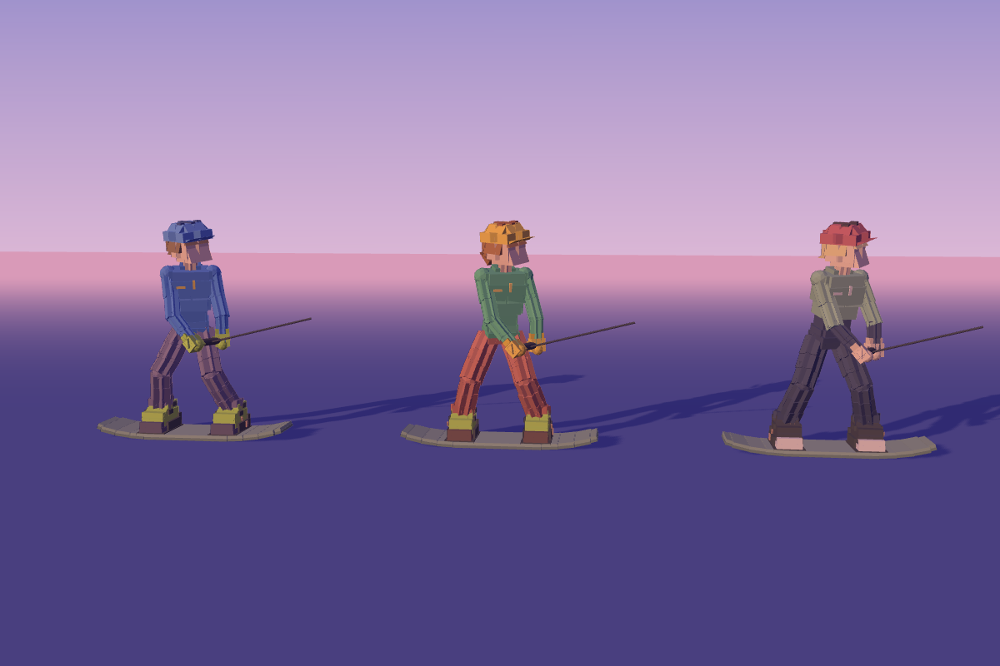
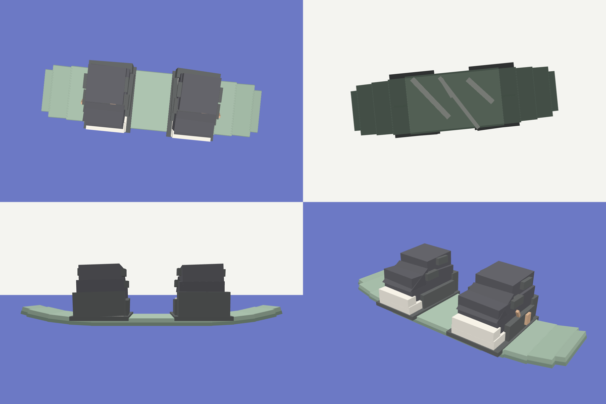

# Cable Wakeboard: Roblox

The Roblox side of the game: the full game simulation (a Luau twin of the web
game's TypeScript sim), a Studio client, and the visual style and rider
character. Art is Luau, primitives only (Block, Wedge, Ball, Cylinder; CornerWedge is allowed but not
needed yet), SmoothPlastic, no textures, decals or faces.



The preview above is a browser render of the exact parts the builder makes
(sizes, CFrames and colours exported from a Luau run), not a Studio
screenshot. Studio lighting will differ.

## Files

```
default.project.json            Rojo project: shared -> ReplicatedStorage.WakeShared,
                                server -> ServerScriptService.WakeServer,
                                client -> StarterPlayer.StarterPlayerScripts.WakeClient
src/shared/Sim/                 The game simulation, one ModuleScript per file (init.luau
                                is the folder's module). Same code as ../src/sim.
src/shared/WakeInput.luau       Held keys -> InputFrame, same keys as the web game
src/client/WakeClient.client.luau  Plays the sim: park, rider, rope, chase camera, HUD
src/shared/RiderBuilder.luau    RiderBuilder.build(options) -> Model
src/shared/DuskLighting.luau    DuskLighting.apply(): sky, haze, sun, post effects
src/shared/WaterSpray.luau      WaterSpray.attach(rider), setIntensity(emitter, 0..1)
src/server/Showcase.server.luau Lake, rocks and one rider per palette, for judging the look
tests/mock_roblox.luau          Tiny Roblox API mock for running the builder outside Studio
tests/rider_spec.luau           Smoke tests: classes, material, welds, height, shades, toggles
tests/run.sh                    Bundles mock + module + spec and runs them with `luau`
tests/sim_trace.luau            Scripted run printed tick by tick (parity test, Luau half)
```

## Getting it into Studio

Everything here is plain files laid out for Rojo, so exporting is a copy, not a
conversion. Either:

- **Rojo (recommended):** install Rojo and its Studio plugin, run `rojo serve`
  in this folder, and click Connect in the plugin. Or `rojo build -o
  CableWakeboard.rbxlx` and open the place file.
- **Studio MCP (local Claude session):** ask Claude to recreate the tree from
  `default.project.json`: a ModuleScript per file in `src/shared` under
  `ReplicatedStorage.WakeShared`, with `Sim` as a ModuleScript made from
  `Sim/init.luau` and every other `Sim/*.luau` as a child ModuleScript of it;
  `src/client/WakeClient.client.luau` as a LocalScript in
  `StarterPlayer.StarterPlayerScripts`; then press Play.
- **By hand:** the same tree, pasting each file into a script of the same name.

`Showcase.server.luau` (the style lineup) and `WakeClient` both build into the
workspace; disable Showcase when playing.

## The simulation

```lua
local Sim = require(game.ReplicatedStorage.WakeShared.Sim)
local run = Sim.Session.createRun() -- default config and park
Sim.Session.stepRun(run, Sim.Input.neutralInput()) -- one 60 Hz tick
print(run.sim.rider.pos.x, run.points, run.pass)
```

Module for module, field for field, the same as `../src/sim`: what the web
game does, this does, to the last bit. `npm run test:parity` (from the parent
folder) proves it: it plays three complete scripted runs (carving, pops,
spins, grabs, jibs, falls, respawns, two passes, judges' scores) through both
and compares every value on every tick. Rules for keeping the two in step are
in `../CLAUDE.md` ("Two versions of the sim").

Units are metres in the sim; `WakeClient` converts to studs (1 stud = 0.28 m).
Vectors are plain `{x, y, z}` tables of doubles, not `Vector3` (float32).

`WakeClient` is a first pass that has not been run in Studio yet; the sim under
it is the verified part.

## Using the builder

```lua
local RiderBuilder = require(game.ReplicatedStorage.WakeShared.RiderBuilder)
local rider = RiderBuilder.build({
	palette = "B", -- "A", "B", "Sheet", or a full palette table
	proportions = { HeadSize = 0.9, BootSize = 1.15 }, -- any CONFIG.Proportions key
	accessories = { Ponytail = true }, -- Helmet, Hair, Ponytail, Handle, Board
	board = "Sage", -- "Sage" (default), "Classic", or a full BoardStyle table
	seed = 3, -- facet layout; same seed, same rider
})
rider:PivotTo(CFrame.new(0, 0.05, 0))
rider.Parent = workspace
```

`Root` is the PrimaryPart (invisible, anchored, centre of the board base);
every other part is welded to it, so one `PivotTo` moves the whole rider.
The handle has an Attachment named `RopeAttachment` for the live rope.

Rider space matches the web sim: +X is the direction of travel (board nose,
toward the carrier), +Y up, +Z the toe side. To place a rider from the sim's
heading `psi`, use `CFrame.new(x, y, z) * CFrame.Angles(0, -psi, 0)`.

## How the style is made

All colours and proportions are in the `CONFIG` table at the top of
`RiderBuilder.luau`, each with a comment.

- Each body segment is several overlapping chunks, each rotated up to
  `ChunkTilt` degrees off its neighbour, plus a thin wedge facet on every
  other chunk.
- Neighbouring chunks differ by `ShadeStep` (6 percent) lightness steps of the
  same hue, which fakes facet lighting.
- Head: a plain skin block and one wedge for the face plane. Helmet: banded
  block, a 45-degree band for an octagonal shell, sloped dome wedges, a brim
  wedge, vents.
- Slim, shaped body: torso sections taper from chest to waist (`TorsoSections`),
  limbs have an octagonal cross-section (each chunk plus a copy turned 45
  degrees), and shoulders, elbows, hips and knees are faceted balls.
- Slightly oversized gloves and chunky boots, legs with a knee bend, a bevelled
  board with rocker and a tow handle in both hands.

Boards (`CONFIG.Board` for the shape, `CONFIG.BoardStyles` for colourways):
**Sage** (default, from the user's board reference: sage green deck, darker
rail layer, black bindings with copper buckles, insert dots, a handle slot and
a pale slash graphic on the base; the reference's logo and sticker are left
out) and **Classic** (charcoal with an accent stripe, no binding hardware).
The rocker is a chain of segments turned up 3, 7 and 13 degrees, and the tips
step in with a narrower end cap for a rounded-square outline.



Palettes: **A** (royal blue jacket, purple-grey pants, lime gloves and boots,
blue helmet), **B** (green jacket, brick red pants, yellow-orange accents,
ponytail), **Sheet** (two-tone sage and navy hoodie, navy cargo pants, red
vented helmet, black boots with cream soles, from the user's turnaround sheet;
colours and clothing only).

## Tests

```
tests/run.sh /path/to/luau                       # rider builder smoke tests
cd .. && LUAU=/path/to/luau npm run test:parity  # sim: Luau vs TypeScript, every tick
```

Needs the `luau` CLI from https://github.com/luau-lang/luau/releases. The mock
covers only what RiderBuilder uses; DuskLighting and WaterSpray are checked for
syntax only (`luau-compile --null`) and need a look in Studio.
